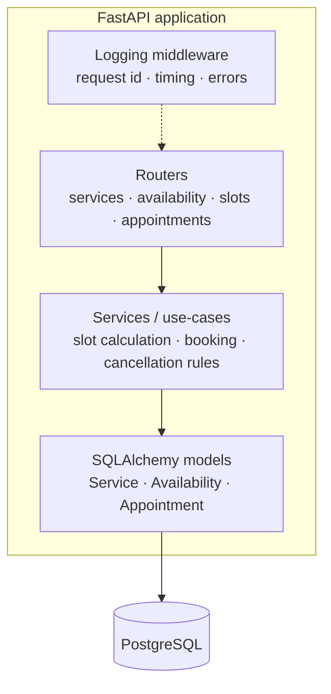

# Backend

The backend is a Python **FastAPI** application that owns all business logic. The frontend is deliberately thin — if a rule matters, it is enforced here.

## Stack

| Concern | Tool | Notes |
|---|---|---|
| Web framework | **FastAPI** | Async, type-hinted, auto-generated OpenAPI docs at `/docs` |
| Runtime | **Python 3.13** | Same version on laptops, CI, and the `python:3.13-slim` image — [ADR-002](../decisions.md#adr-002-python-313) |
| Dependencies | **uv** + `pyproject.toml` + `uv.lock` | `uv sync` installs identical versions everywhere — [ADR-004](../decisions.md#adr-004-uv-pyprojecttoml-for-dependencies) |
| ASGI server | **uvicorn** | `uv run uvicorn app.main:app --reload` locally; no `--reload` in containers |
| ORM | **SQLAlchemy** | Declarative models for `services`, `availability`, `appointments` |
| Migrations | **Alembic** | Every schema change is a migration. `alembic upgrade head` runs in CI and on deploy. |
| Validation | **Pydantic** | Request/response schemas (comes with FastAPI) |
| Database | **PostgreSQL** | Via Docker everywhere |
| Logging | stdlib `logging` | One structured stdout/stderr pipeline — [ADR-010](../decisions.md#adr-010-standard-library-logging) |
| Lint / format | **Ruff** · **Black** | Enforced in CI — see [Coding standards](../development/coding-standards.md) |
| Tests | **pytest** | Integration tests against a seeded PostgreSQL |

## Responsibilities



| Layer | Owns |
|---|---|
| **Routers** | HTTP concerns: paths, status codes, Pydantic schemas, auth for admin routes |
| **Services / use-cases** | The business rules: [dynamic time blocking](../product/business-rules.md#dynamic-time-blocking), [24-hour cancellation](../product/business-rules.md#24-hour-cancellation-rule), service lifecycle |
| **Models** | Tables, relationships, constraints — see [Data model](data-model.md) |
| **Logging middleware** | Correlation id per request, duration, unhandled exception capture with stack trace |

## Application entry point

`app.main.create_app()` builds an isolated FastAPI application from validated
settings. Uvicorn uses the module-level `app` created by that factory:

```powershell
uv run uvicorn app.main:app --reload
```

`GET /health` returns the process status and configured environment:

```json
{"status": "ok", "env": "local"}
```

Swagger at `/docs`, ReDoc at `/redoc`, and the OpenAPI document are available
in local and CI environments. All three are disabled in production.

Startup configures the shared console logger using `LOG_LEVEL`. HTTP middleware
returns a generated `X-Request-ID` and logs status and elapsed time for every
request. Application logs share that ID automatically; see
[Request logging](../development/logging.md#request-logging). Full exception
tracebacks and JSON error handling are implemented separately in #15.

## API surface (MVP)

The exact paths are finalised during Sprints 2–3. The resources are fixed:

=== "Services"

    | Method | Path | Who | Purpose |
    |---|---|---|---|
    | `GET` | `/services` | client, admin | List **active** services |
    | `POST` | `/admin/services` | admin | Create a service |
    | `PATCH` | `/admin/services/{id}` | admin | Edit name / price / duration / active |

=== "Availability"

    | Method | Path | Who | Purpose |
    |---|---|---|---|
    | `GET` | `/admin/availability?from=&to=` | admin | Windows in a date range |
    | `POST` | `/admin/availability` | admin | Add a window (date, start, end) |
    | `DELETE` | `/admin/availability/{id}` | admin | Remove a window (block time) |

=== "Slots"

    | Method | Path | Who | Purpose |
    |---|---|---|---|
    | `GET` | `/slots?service_id=&date=` | client, admin | Valid start times — see [Booking algorithm](booking-algorithm.md) |

=== "Appointments"

    | Method | Path | Who | Purpose |
    |---|---|---|---|
    | `POST` | `/appointments` | client, admin | Book (re-validates slot in a transaction) |
    | `DELETE` | `/appointments/{id}` | client | Cancel — enforces 24 h rule |
    | `GET` | `/admin/appointments?from=&to=` | admin | Daily / weekly schedule |
    | `DELETE` | `/admin/appointments/{id}` | admin | Cancel — no time restriction |

!!! warning "Admin authentication is undecided"
    Routes under `/admin/*` need *some* protection beyond an unlisted URL. Decide in Sprint 2 (e.g. a static bearer token from an environment variable is the minimum viable option).

## Configuration

All configuration comes from **environment variables** (12-factor). Never hard-code secrets.

| Variable | Example | Purpose |
|---|---|---|
| `DATABASE_URL` | `postgresql+psycopg://tzamot:***@db:5432/tzamot` | SQLAlchemy connection string |
| `ENV` | `local` · `ci` · `staging` · `production` | Toggles log verbosity, docs exposure |
| `LOG_LEVEL` | `DEBUG` · `INFO` | See [Logging](../development/logging.md) |
| `CORS_ORIGINS` | `https://tzamot.co.il` | Allowed frontend origins |
| `TZ` | `Asia/Jerusalem` | Business timezone |
| `ADMIN_TOKEN` | *secret* | Admin route protection (if that option is chosen) |

Locally these live in `backend/.env` (git-ignored, copied from `.env.example`). In production they live in `/opt/tzamot/.env` on the VPS. Full per-environment table on the [Environments](environments.md#configuration-per-environment) page.

## Running

All commands from `backend/`, via `uv run` so the project's virtual environment is used automatically:

| Context | Command |
|---|---|
| Local dev | `uv run uvicorn app.main:app --reload --port 8000` (DB in Docker) |
| Container | `uvicorn app.main:app --host 0.0.0.0 --port 8000` via the image's `CMD` |
| Migrations | `uv run alembic upgrade head` |
| Seed (CI / local) | `uv run python scripts/seed_test_db.py` |
| Tests | `uv run pytest` |

## Dockerfile

??? example "backend/Dockerfile (reference)"
    ```dockerfile
    FROM ghcr.io/astral-sh/uv:0.13.6 AS uv
    FROM python:3.13-slim

    ENV PYTHONDONTWRITEBYTECODE=1 \
        PYTHONUNBUFFERED=1 \
        UV_COMPILE_BYTECODE=1 \
        PATH="/app/.venv/bin:$PATH"

    COPY --from=uv /uv /uvx /bin/

    WORKDIR /app

    COPY pyproject.toml uv.lock ./
    RUN uv sync --frozen --no-dev --no-install-project

    RUN groupadd --system app \
        && useradd --system --gid app --home-dir /app --no-create-home app

    COPY --chown=app:app . .

    USER app
    EXPOSE 8000
    CMD ["uvicorn", "app.main:app", "--host", "0.0.0.0", "--port", "8000"]
    ```

    `--frozen` fails the build if `uv.lock` is out of date — the lockfile is
    the contract. `.dockerignore` keeps local environments, tests, caches, and
    dotenv files out of the build context. The process runs as the unprivileged
    `app` user.
