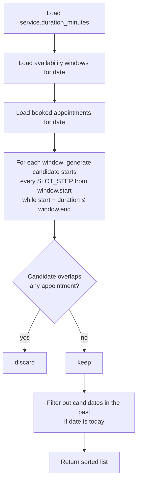
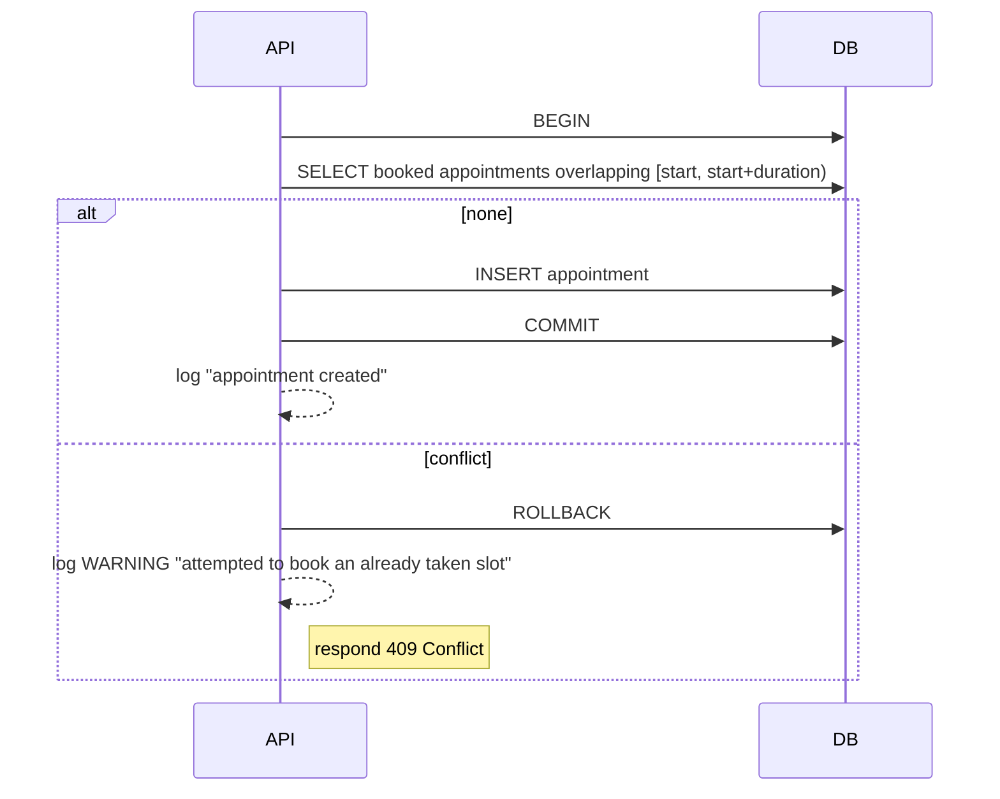

# Booking Algorithm

The core of the product: given a **date** and a **service**, return every start time at which the service fits. This is "Sprint 3: Core Complexity".

## Inputs & output

| | |
|---|---|
| **Input** | `date` (local, Asia/Jerusalem), `service_id` |
| **Reads** | `availability` rows for `date`; `appointments` with `status = booked` overlapping `date`; `services.duration_minutes` |
| **Output** | Sorted list of valid start times (e.g. `["09:00", "09:30", "11:00"]`) |
| **Parameter** | `SLOT_STEP_MINUTES` — granularity of candidate starts (proposed: 30; confirm in Sprint 3) |

## Algorithm



### Pseudocode

```python
def available_slots(date, service, windows, appointments, step=30):
    duration = timedelta(minutes=service.duration_minutes)
    busy = [(a.starts_at, a.ends_at) for a in appointments if a.status == "booked"]
    slots = []

    for w in windows:                      # each availability window on `date`
        t = w.start
        while t + duration <= w.end:       # must fit entirely inside the window
            candidate = (t, t + duration)
            if not any(overlaps(candidate, b) for b in busy):
                slots.append(t)
            t += timedelta(minutes=step)

    now = current_time_in_business_tz()
    return sorted(t for t in slots if t > now)


def overlaps(a, b):
    # half-open intervals: touching edges do NOT overlap
    return a[0] < b[1] and b[0] < a[1]
```

## Edge cases the tests must cover

- [ ] Empty day (no availability) → `[]`
- [ ] Service longer than the window → `[]`
- [ ] Service exactly equal to the window → one slot at `window.start`
- [ ] Back-to-back appointments: a slot ending exactly when another starts **is valid**
- [ ] Split shift: candidates never span the gap between windows
- [ ] Cancelled appointments do not block
- [ ] Disabled service → `400`/`404`, no slots
- [ ] Today's date: past times are excluded
- [ ] Date in the past → `[]`
- [ ] Appointment that starts before the window and ends inside it (admin manual booking at odd time) still blocks correctly

Worked examples with tables are in [Business rules → Dynamic time blocking](../product/business-rules.md#dynamic-time-blocking).

## Booking: the second check

The slot list is a **snapshot**. Between the client seeing it and tapping "Book", someone else may have booked. The booking endpoint therefore:



- Runs inside **one transaction**.
- Re-validates that `start` is a valid slot (inside a window, not overlapping, not in the past) — not just "not overlapping".
- Optional hardening: the PostgreSQL exclusion constraint described in [Data model](data-model.md#the-no-overlap-guarantee) makes even a concurrent `INSERT` fail safely.

## Performance

For one business with a handful of appointments per day, the naive O(windows × candidates × appointments) approach is more than fast enough. Index `appointments.starts_at` and `availability.date`; do not optimise further for the MVP.
