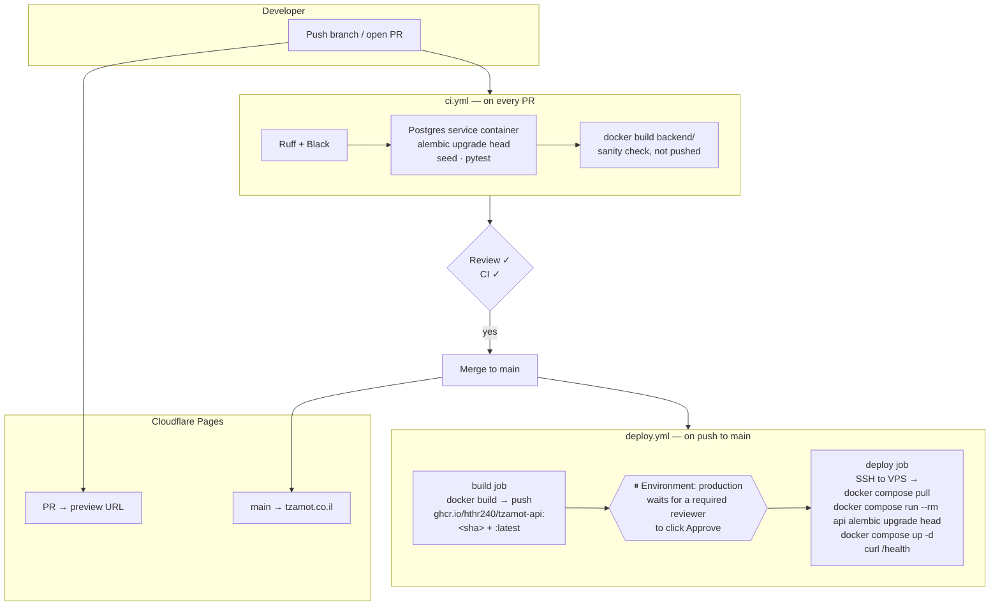

# CI/CD Pipeline Design

How code moves from a developer's laptop to production, and what checks it passes on the way.

- **CI** (Continuous Integration) — *automatic checking*: every push/PR is linted and tested on a throwaway GitHub server. Defined in [`ci.yml`](../development/ci-pipeline.md).
- **CD** (Continuous Deployment) — *automatic shipping*: after a merge to `main`, GitHub builds the Docker image and — once a human clicks **approve** — installs it on the VPS. Defined in `deploy.yml` (this page).

## End-to-end flow



## Stage 1 — CI on every pull request

Unchanged from the [CI pipeline](../development/ci-pipeline.md) page, with two additions now that the layout is decided:

| Addition | Why |
|---|---|
| **Path filter** | The `backend` job only runs when `backend/**` or the workflow changes; docs-only or frontend-only PRs don't wait on Python tests. |
| **`docker build` step** | Catches a broken `Dockerfile` *before* merge, so `deploy.yml` never fails on build. The image is built but **not pushed**. |

Dependencies are installed with **`uv sync --frozen`** from `uv.lock`, so CI uses exactly the versions developers have locally.

## Stage 2 — Build & publish the image (on merge to `main`)

```
ghcr.io/hthr240/tzamot-api:<git-sha>     ← immutable, what gets deployed
ghcr.io/hthr240/tzamot-api:latest        ← convenience alias
```

- **GHCR** (GitHub Container Registry) is free for this repo and uses the automatic `GITHUB_TOKEN` — no extra account.
- Tagging by **commit SHA** means every deploy is traceable to an exact commit and rollback is "deploy the previous SHA".
- The image contains code + dependencies only. **No `.env`, no secrets.**

## Stage 3 — Approval gate

GitHub **Environments** (Settings → Environments → `production`):

| Setting | Value |
|---|---|
| Required reviewers | Team lead (and optionally the second developer) |
| Deployment branches | `main` only |
| Secrets | `VPS_HOST`, `VPS_USER`, `VPS_SSH_KEY` |

When the `deploy` job reaches this environment, the run **pauses** and GitHub shows a *"Review deployments"* button. Nothing touches production until someone clicks it. This is the safety net that replaces staging for the MVP — deploy during quiet hours, never mid-afternoon on a Friday.

## Stage 4 — Deploy to the VPS

The `deploy` job connects over SSH (key from the environment secret) and runs, in `/opt/tzamot`:

```bash
docker compose -f docker-compose.prod.yml pull api
docker compose -f docker-compose.prod.yml run --rm api alembic upgrade head
docker compose -f docker-compose.prod.yml up -d
curl -fsS https://api.tzamot.co.il/health
```

Order matters: **migrate first, then restart** — the new code never runs against an old schema. If `alembic` or the health check fails, the job goes red and the old container keeps serving (`up -d` only replaces when the image changed and migrations succeeded).

??? example ".github/workflows/deploy.yml (reference)"
    ```yaml
    name: Deploy

    on:
      push:
        branches: [main]
        paths:
          - "backend/**"
          - "infra/**"
          - ".github/workflows/deploy.yml"
      workflow_dispatch:        # manual re-deploy / rollback button

    permissions:
      contents: read
      packages: write

    env:
      IMAGE: ghcr.io/hthr240/tzamot-api

    jobs:
      build:
        runs-on: ubuntu-latest
        steps:
          - uses: actions/checkout@v4
          - uses: docker/login-action@v3
            with:
              registry: ghcr.io
              username: ${{ github.actor }}
              password: ${{ secrets.GITHUB_TOKEN }}
          - uses: docker/build-push-action@v6
            with:
              context: backend
              push: true
              tags: |
                ${{ env.IMAGE }}:${{ github.sha }}
                ${{ env.IMAGE }}:latest

      deploy:
        needs: build
        runs-on: ubuntu-latest
        environment:
          name: production          # ← pauses for approval here
          url: https://api.tzamot.co.il
        steps:
          - uses: appleboy/ssh-action@v1
            with:
              host: ${{ secrets.VPS_HOST }}
              username: ${{ secrets.VPS_USER }}
              key: ${{ secrets.VPS_SSH_KEY }}
              script: |
                set -e
                cd /opt/tzamot
                export API_IMAGE=${{ env.IMAGE }}:${{ github.sha }}
                docker compose -f docker-compose.prod.yml pull api
                docker compose -f docker-compose.prod.yml run --rm api alembic upgrade head
                docker compose -f docker-compose.prod.yml up -d
                curl -fsS https://api.tzamot.co.il/health
    ```

    `docker-compose.prod.yml` references `image: ${API_IMAGE:-ghcr.io/hthr240/tzamot-api:latest}` so the exact SHA is pinned per deploy.

## Rollback

1. Open **Actions → Deploy**, find the last green run, click **Re-run jobs**. It rebuilds and redeploys that commit.
2. Or, on the VPS: `API_IMAGE=ghcr.io/hthr240/tzamot-api:<previous-sha> docker compose -f docker-compose.prod.yml up -d`.

Alembic **downgrades are not run automatically** — if a migration must be reverted, do it deliberately by hand.

## Frontend deployment

Handled entirely by **Cloudflare Pages** — no workflow needed:

| Event | Result |
|---|---|
| Open / update a PR | Preview URL `https://<hash>.tzamot.pages.dev` posted on the PR |
| Merge to `main` | `https://tzamot.co.il` updated within seconds |

Pages settings: root directory `frontend/`, no build command, production branch `main`.

## Docs deployment

[`docs.yml`](https://github.com/hthr240/tzamot/blob/main/.github/workflows/docs.yml): strict `mkdocs build` on every docs PR; publish to GitHub Pages on `main`.

## One-time setup checklist (team lead)

- [ ] Settings → Environments → **production**: add required reviewer(s), restrict to `main`
- [ ] Generate a deploy SSH key pair; public key → VPS `~/.ssh/authorized_keys`; private key → environment secret `VPS_SSH_KEY`
- [ ] Add `VPS_HOST`, `VPS_USER` secrets
- [ ] On the VPS: `mkdir /opt/tzamot`, copy `docker-compose.prod.yml` + `Caddyfile`, create `.env` by hand
- [ ] First deploy manually (`docker compose up -d`) so Caddy obtains certificates; subsequent deploys via Actions
- [ ] Mark `backend` (CI) as a required status check on `main`
- [ ] Connect repo to Cloudflare Pages
