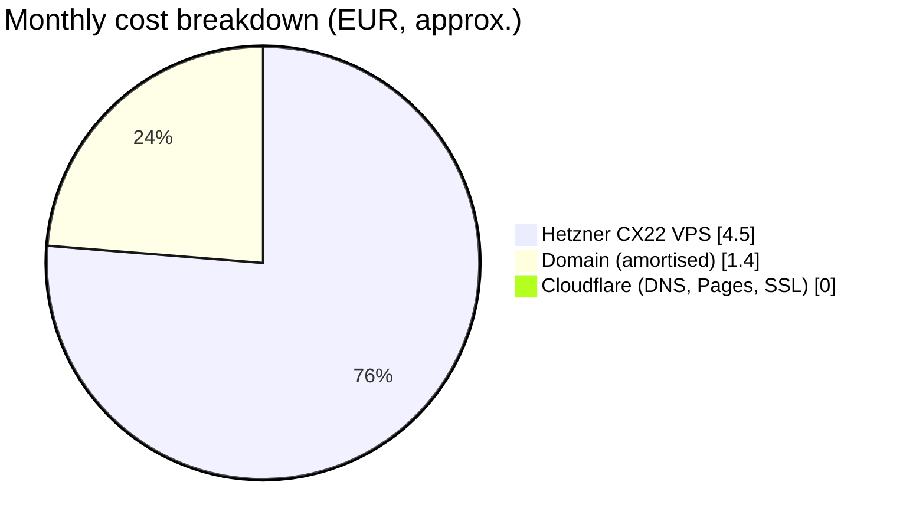

# Cost Analysis

Monthly running cost of the production architecture. The design deliberately trades a small fixed fee for **zero free-tier limitations** (no DB pausing, no cold starts, no row caps).

## Estimate

| Component | Provider | Purpose | Estimated cost |
|---|---|---|---|
| **Domain name** | Local registrar (e.g. Box, Domain The Net) | `*.co.il` address ownership | ~$15 – 20 / **year** |
| **DNS & SSL** | Cloudflare | Traffic routing, DDoS protection, edge SSL | $0 / month |
| **Frontend hosting** | Cloudflare Pages | Hosting the PWA (HTML / JS / CSS) | $0 / month |
| **Backend server** | Hetzner Cloud | CX22 — 2 vCPU, 4 GB RAM, 40 GB disk | **~€4.50 / month** |
| **Database** | Self-hosted (Docker) | PostgreSQL | $0 (uses VPS resources) |
| **Reverse proxy** | Self-hosted (Docker) | Caddy — routing & TLS | $0 (uses VPS resources) |
| **CI/CD** | GitHub Actions | Public repo: free · Private repo: 2 000 min / month free | $0 (within free minutes) |
| **Total** | | | **≈ €4.50 / month + ~$1.50 / month domain** |

## What the free tiers give us

| Service | Free tier limits | Our expected usage |
|---|---|---|
| Cloudflare Pages | 500 builds / month, unlimited bandwidth | A few dozen deploys / month |
| Cloudflare DNS / proxy | Unlimited | Trivial |
| GitHub Actions | 2 000 min / month (private) | ~5 min per CI run × ~100 runs = 500 min |

## Likely future costs (post-MVP)

| Feature | Rough cost |
|---|---|
| SMS / WhatsApp reminders | Per-message fee from a provider (e.g. Twilio, 019 SMS); a few ₪ per day at this volume |
| Payments | Clearing-company fees (percentage per transaction) |
| Backups to object storage | Hetzner Storage Box from ~€3.20 / month, or Cloudflare R2 free tier (10 GB) |
| Staging VPS (if separate) | Another CX22, ~€4.50 / month |
| Larger VPS | CX32 (4 vCPU, 8 GB) ~€7.50 / month — only if ever needed |
