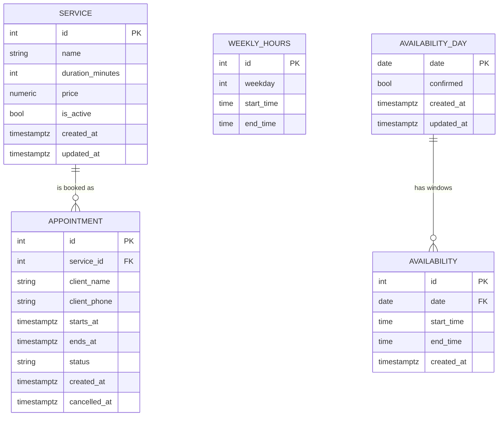

# Data Model

!!! warning "Draft — finalised in Sprint 1"
    [ADR-008](../decisions.md#adr-008-materialised-weekly-working-hours) fixes the weekly-hours tables. Column details below stay a proposal until the SQLAlchemy models and the first Alembic migration in [Sprint 1](../roadmap/sprint-1.md) land. Update this page when they do.

## Entity-relationship diagram



`WEEKLY_HOURS` is the default week. `AVAILABILITY_DAY` is one generated date, and `AVAILABILITY` is a concrete window on that date. Slots are computed from `AVAILABILITY` minus booked `APPOINTMENT` rows. See [ADR-008](../decisions.md#adr-008-materialised-weekly-working-hours).

## Tables

### `services`

| Column | Type | Constraints | Notes |
|---|---|---|---|
| `id` | serial | PK | |
| `name` | varchar | not null | Shown to clients (Hebrew) |
| `duration_minutes` | int | not null, `> 0` | **Drives slot calculation** |
| `price` | numeric(10,2) | not null, `>= 0` | ILS; payment on-site |
| `is_active` | bool | not null, default `true` | Disabled services are hidden, never deleted |
| `created_at` / `updated_at` | timestamptz | | |

### `weekly_hours`

The default week. Editing it does not change a date she has already confirmed.

| Column | Type | Constraints | Notes |
|---|---|---|---|
| `id` | serial | PK | |
| `weekday` | smallint | not null, `0–6` | `0` Sunday through `6` Saturday |
| `start_time` | time | not null | |
| `end_time` | time | not null, `> start_time` | |

- Several rows on the same weekday = **split shift** in the template.
- No row for a weekday = that weekday is closed in the template.

### `availability_days`

One row for each date the generator has created from the template.

| Column | Type | Constraints | Notes |
|---|---|---|---|
| `date` | date | PK | |
| `confirmed` | bool | not null, default `false` | `true` after she verifies or edits that date |
| `created_at` / `updated_at` | timestamptz | | |

A generator copies `weekly_hours` onto upcoming dates. Sprint 2 chooses how many weeks ahead to keep. The next week is always generated so she can verify it. Verifying a week sets `confirmed` and leaves the windows unchanged. Changing the template rebuilds windows only where `confirmed` is false.

### `availability`

The windows clients can book. The slot algorithm reads this table and does not consult the template.

| Column | Type | Constraints | Notes |
|---|---|---|---|
| `id` | serial | PK | |
| `date` | date | FK → `availability_days.date`, not null, indexed | |
| `start_time` | time | not null | |
| `end_time` | time | not null, `> start_time` | |
| `created_at` | timestamptz | | |

- Several rows on the same date = **split shift**.
- A confirmed date with no rows = closed.
- Blocking hours replaces that date's windows and sets `availability_days.confirmed`. The template and other dates stay as they are.

### `appointments`

| Column | Type | Constraints | Notes |
|---|---|---|---|
| `id` | serial | PK | |
| `service_id` | int | FK → `services.id`, not null | Keeps history even if the service is disabled |
| `client_name` | varchar | not null | |
| `client_phone` | varchar | not null, indexed | Normalised (e.g. `05XXXXXXXX`) to enable a future CRM |
| `starts_at` | timestamptz | not null, indexed | |
| `ends_at` | timestamptz | not null | `= starts_at + service.duration_minutes` at booking time |
| `status` | enum | `booked` · `cancelled` | Soft-cancel; never delete |
| `created_at` | timestamptz | | |
| `cancelled_at` | timestamptz | nullable | |

#### The no-overlap guarantee

The application layer re-validates the slot inside a transaction. For defence in depth, PostgreSQL can also enforce it with an **exclusion constraint** on a time range (requires the `btree_gist` extension):

```sql
ALTER TABLE appointments
  ADD CONSTRAINT no_overlapping_appointments
  EXCLUDE USING gist (
    tstzrange(starts_at, ends_at) WITH &&
  ) WHERE (status = 'booked');
```

With this in place a race between two clients results in a constraint violation → the API returns `409 Conflict`. Recommended for Sprint 3.

## Conventions

- Store all timestamps as `timestamptz` in **UTC**; convert to `Asia/Jerusalem` at the API boundary.
- Soft-delete (`is_active`, `status = cancelled`) instead of hard-delete.
- Every schema change ships as an **Alembic migration** in the same PR as the model change.

## Seed data (CI & local)

`scripts/seed_test_db.py` populates a realistic dataset so integration tests exercise real logic:

- 5 predefined services with varied durations (30 – 240 min)
- 2 weeks of availability, including at least one split-shift day and one closed day
- A handful of booked appointments, including back-to-back ones and one cancelled

See [CI pipeline](../development/ci-pipeline.md#database-seeding).
