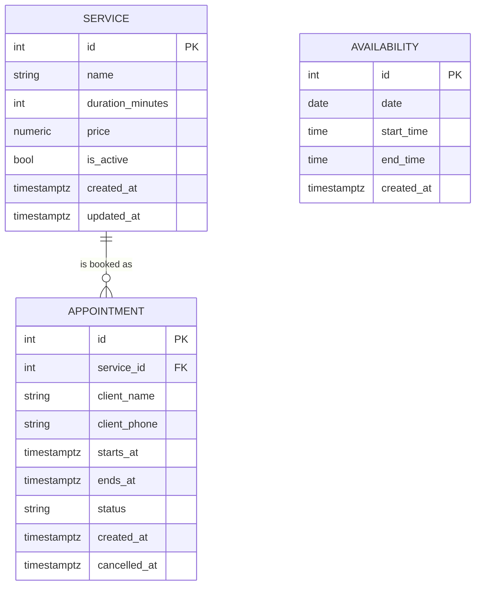

# Data Model

!!! warning "Draft — finalised in Sprint 1"
    The roadmap names three tables: **Services**, **Availability**, **Appointments**. The fields below are a proposal derived from the PRD; the SQLAlchemy models and the first Alembic migration written in [Sprint 1](../roadmap/sprint-1.md) are the real source of truth. Update this page when they land.

## Entity-relationship diagram



`AVAILABILITY` has no foreign keys — it is a pure "the admin is working on `date` from `start_time` to `end_time`" fact. Slots are computed by intersecting it with `APPOINTMENT`.

## Tables

### `services`

| Column | Type | Constraints | Notes |
|---|---|---|---|
| `id` | serial | PK | |
| `name` | varchar | not null | Shown to clients (Hebrew) |
| `duration_minutes` | int | not null, `> 0` | **Drives slot calculation** |
| `price` | numeric(10,2) | not null, `>= 0` | ILS; payment on-site |
| `is_active` | bool | not null, default `true` | Disabled services are hidden, never deleted |
| `created_at` / `updated_at` | timestamptz | | |

### `availability`

| Column | Type | Constraints | Notes |
|---|---|---|---|
| `id` | serial | PK | |
| `date` | date | not null, indexed | |
| `start_time` | time | not null | |
| `end_time` | time | not null, `> start_time` | |

- Several rows on the same date = **split shift**.
- No row on a date = closed.
- "Block hours" is modelled by **not** having an availability row covering them (shrink or split the window).

??? question "Weekly working-hours template"
    The PRD says the admin defines hours *on a weekly basis* and then customises specific days. Two options:

    1. **Materialise**: a `weekly_hours` template table (`weekday`, `start`, `end`) that a job expands into `availability` rows N weeks ahead. Overrides edit the `availability` rows directly.
    2. **Compute**: store the template plus an `availability_overrides` table and merge at query time.

    Option 1 is simpler to reason about and query. Decide in Sprint 1 / early Sprint 2.

### `appointments`

| Column | Type | Constraints | Notes |
|---|---|---|---|
| `id` | serial | PK | |
| `service_id` | int | FK → `services.id`, not null | Keeps history even if the service is disabled |
| `client_name` | varchar | not null | |
| `client_phone` | varchar | not null, indexed | Normalised (e.g. `05XXXXXXXX`) to enable a future CRM |
| `starts_at` | timestamptz | not null, indexed | |
| `ends_at` | timestamptz | not null | `= starts_at + service.duration_minutes` at booking time |
| `status` | enum | `booked` · `cancelled` | Soft-cancel; never delete |
| `created_at` | timestamptz | | |
| `cancelled_at` | timestamptz | nullable | |

#### The no-overlap guarantee

The application layer re-validates the slot inside a transaction. For defence in depth, PostgreSQL can also enforce it with an **exclusion constraint** on a time range (requires the `btree_gist` extension):

```sql
ALTER TABLE appointments
  ADD CONSTRAINT no_overlapping_appointments
  EXCLUDE USING gist (
    tstzrange(starts_at, ends_at) WITH &&
  ) WHERE (status = 'booked');
```

With this in place a race between two clients results in a constraint violation → the API returns `409 Conflict`. Recommended for Sprint 3.

## Conventions

- Store all timestamps as `timestamptz` in **UTC**; convert to `Asia/Jerusalem` at the API boundary.
- Soft-delete (`is_active`, `status = cancelled`) instead of hard-delete.
- Every schema change ships as an **Alembic migration** in the same PR as the model change.

## Seed data (CI & local)

`scripts/seed_test_db.py` populates a realistic dataset so integration tests exercise real logic:

- 5 predefined services with varied durations (30 – 240 min)
- 2 weeks of availability, including at least one split-shift day and one closed day
- A handful of booked appointments, including back-to-back ones and one cancelled

See [CI pipeline](../development/ci-pipeline.md#database-seeding).
