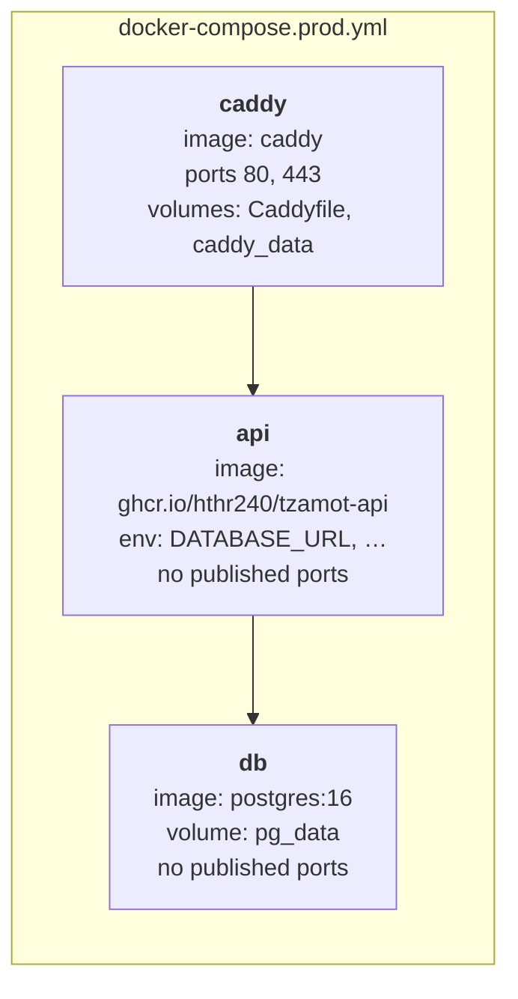

# Deployment & Hosting

How the system runs in production. Frontend on **Cloudflare Pages**, backend on a **Hetzner Cloud VPS** running three Docker containers behind **Caddy**.

!!! info "Related pages"
    - **How code gets here:** [CI/CD pipeline](cicd.md) — GitHub Actions builds the image and deploys over SSH after approval.
    - **What differs per environment:** [Environments](environments.md).
    - **Why these choices:** [Decision log](../decisions.md).

## Frontend — Cloudflare Pages

| Setting | Value |
|---|---|
| Source | GitHub repo `hthr240/tzamot`, frontend directory |
| Build command | *none* (static files) |
| Production branch | `main` → `https://tzamot.co.il` |
| Preview deployments | Every PR gets `https://<hash>.tzamot.pages.dev` |
| Custom domain | Root domain via Cloudflare DNS (CNAME flattening) |

Pushes to `main` deploy within seconds. No action needed from developers.

## Backend — Hetzner Cloud VPS

| Setting | Value |
|---|---|
| Instance | **CX22** — 2 vCPU, 4 GB RAM, 40 GB disk |
| Location | Germany (Hetzner data centre) |
| OS | Ubuntu LTS |
| Installed | Docker Engine + Compose plugin, `ufw` (allow 22, 80, 443) |
| Access | SSH key only; password login disabled |

### Containers



| Container | Image | Published ports | Persistent volume | Purpose |
|---|---|---|---|---|
| `caddy` | `caddy:2` | 80, 443 | `caddy_data` (certificates) | TLS termination, reverse proxy to `api:8000` |
| `api` | `ghcr.io/hthr240/tzamot-api:<sha>` built from `backend/Dockerfile` | — | — | FastAPI via uvicorn |
| `db` | `postgres:16` | — | `pg_data` | Data survives container restarts and image upgrades |

### Caddyfile

The whole reverse-proxy configuration:

```caddyfile
api.tzamot.co.il {
    reverse_proxy api:8000
}
```

Caddy obtains a Let's Encrypt certificate on first start and renews it automatically.

### Startup order

`api` depends on `db` being healthy. Migrations are run **by the deploy workflow** as an explicit step (`docker compose run --rm api alembic upgrade head`) before `up -d` — see [CI/CD → Stage 4](cicd.md#stage-4-deploy-to-the-vps). The API never starts against an un-migrated schema.

### Files on the VPS

```
/opt/tzamot/
├── docker-compose.prod.yml     copied from infra/
├── Caddyfile                   copied from infra/
└── .env                        created by hand — never in git
```

??? example "infra/docker-compose.prod.yml (reference)"
    ```yaml
    services:
      caddy:
        image: caddy:2
        restart: unless-stopped
        ports: ["80:80", "443:443"]
        volumes:
          - ./Caddyfile:/etc/caddy/Caddyfile:ro
          - caddy_data:/data
          - caddy_config:/config
        depends_on: [api]

      api:
        image: ${API_IMAGE:-ghcr.io/hthr240/tzamot-api:latest}
        restart: unless-stopped
        env_file: .env
        depends_on:
          db:
            condition: service_healthy
        logging:
          driver: json-file
          options: { max-size: "10m", max-file: "5" }

      db:
        image: postgres:16
        restart: unless-stopped
        env_file: .env            # POSTGRES_USER / POSTGRES_PASSWORD / POSTGRES_DB
        volumes:
          - pg_data:/var/lib/postgresql/data
        healthcheck:
          test: ["CMD-SHELL", "pg_isready -U $$POSTGRES_USER"]
          interval: 5s
          retries: 10

    volumes:
      caddy_data:
      caddy_config:
      pg_data:
    ```

## DNS

Managed in **Cloudflare**.

| Record | Type | Target | Proxy |
|---|---|---|---|
| `tzamot.co.il` | CNAME | `tzamot.pages.dev` | ☁️ proxied |
| `api.tzamot.co.il` | A | `<VPS public IP>` | ☁️ proxied (or DNS-only if Caddy's HTTP challenge is preferred) |

!!! tip "Cloudflare proxy + Caddy"
    If the `api` record is proxied, Cloudflare terminates TLS at its edge and connects to the VPS. Set Cloudflare SSL mode to **Full (strict)** so the hop to Caddy is also encrypted. Alternatively keep `api` DNS-only and let Caddy handle everything — simpler for the MVP.

## Launch checklist (Sprint 4)

- [ ] Register the domain
- [ ] Add domain to Cloudflare, switch nameservers
- [ ] Connect repo to Cloudflare Pages: root directory `frontend/`, production branch `main`
- [ ] Provision Hetzner CX22, add SSH key, disable password login, `ufw allow 22,80,443`, install Docker
- [ ] Create a dedicated deploy SSH key; add to VPS and to the GitHub `production` environment — see [CI/CD → One-time setup](cicd.md#one-time-setup-checklist-team-lead)
- [ ] `mkdir /opt/tzamot`; copy `docker-compose.prod.yml` + `Caddyfile`; write `.env` by hand
- [ ] First `docker compose up -d` by hand so Caddy obtains certificates → verify `https://api.tzamot.co.il/health`
- [ ] Point DNS records, verify SSL on both hostnames
- [ ] Set `CORS_ORIGINS` to the production frontend URL
- [ ] Trigger `deploy.yml` from Actions and approve — confirm the automated path works
- [ ] Smoke-test a full booking from a phone

## Operations

| Topic | Plan |
|---|---|
| **Secrets** | `/opt/tzamot/.env` on the VPS; SSH key + host in GitHub Environment secrets; nothing in images — see [Environments → Where secrets live](environments.md#where-secrets-live) |
| **Logs** | Docker `json-file` driver with rotation (`max-size: 10m`, `max-file: 5`); `docker compose logs -f api` — see [Logging](../development/logging.md) |
| **Backups** | Nightly `pg_dump` via a cron job or sidecar container to Hetzner Storage Box or Cloudflare R2 (free 10 GB). **Set up before real clients book** — Sprint 4 checklist. |
| **Monitoring** | Free uptime check on `https://api.tzamot.co.il/health` (e.g. UptimeRobot) alerting the team lead's phone |
| **Updates** | `apt upgrade` + `docker compose pull db caddy` monthly; Postgres major upgrades are a deliberate, backed-up task |
| **Rollback** | Re-run the previous green `Deploy` workflow — see [CI/CD → Rollback](cicd.md#rollback) |
