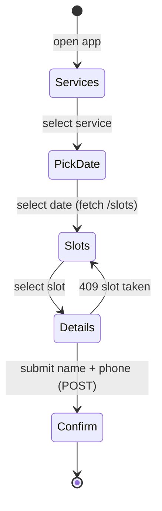

# Frontend (PWA)

The frontend is a **static, mobile-first Progressive Web App** written in plain HTML, CSS, and Vanilla JavaScript. No framework, no build step.

## Why static + vanilla?

- **Zero build pipeline** — push to `main`, Cloudflare Pages serves it seconds later.
- **Zero backend load** — HTML/CSS/JS come from Cloudflare's edge, not the VPS.
- **Resilient** — the UI stays online even while the API restarts.
- **Small surface** — ~4 screens; both developers can read the whole thing in an afternoon.

## Pages

| Page | Audience | Purpose |
|---|---|---|
| `index.html` | Client | Service list → date picker → slots → name/phone form → confirmation |
| `cancel.html` *(or a section of index)* | Client | Look up and cancel an appointment (24 h rule enforced by the API) |
| `admin.html` | Admin | **Hidden / unlisted.** Manage services, availability, view daily/weekly schedule, manual booking, cancel |

## PWA requirements (Sprint 4)

| Piece | Purpose |
|---|---|
| `manifest.json` | App name, Hebrew `dir: rtl`, `lang: he`, theme colours, home-screen icons, `display: standalone` |
| Service worker | Minimum: register so browsers offer **"Add to Home Screen"**. Cache the app shell for instant loads. **Never cache API responses** — slots must always be live. |
| `<meta name="viewport">` + `theme-color` | Native-feeling chrome on iOS/Android |

## Talking to the API

- All data access goes through `fetch()` to the API base URL.
- The base URL differs per environment (`http://localhost:8000` locally, `https://api.tzamot.co.il` in production). Keep it in a single `config.js` — the exact mechanism (build-time replacement vs. hostname detection) is an infra-phase decision.
- Always show a **loading spinner** while a request is in flight.
- Map API errors to **friendly Hebrew messages** — e.g. `409 Conflict` → "השעה הזו נתפסה הרגע, אנא בחרי שעה אחרת".

## UI conventions

- **Hebrew, RTL**: `<html lang="he" dir="rtl">`.
- **Mobile-first CSS**: design for ~360 px wide, enhance upward.
- **Big tap targets** — the admin uses this one-handed while working.
- **No client-side rule enforcement as the only line of defence** — hide what's not allowed for UX, but trust the API's answer.

## Hosting

Cloudflare Pages connected to the GitHub repository. Production deploys on push to `main`; pull requests get **preview URLs** automatically — a natural candidate for the staging story. See [Deployment](deployment.md#frontend-cloudflare-pages).
