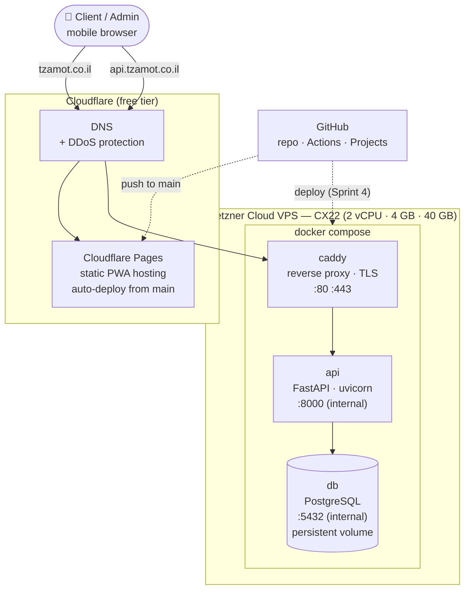

# Architecture Overview

!!! abstract "Source"
    Living version of the original **Infrastructure Architecture Report**. Design goals: **24/7 availability**, **low fixed cost**, **no free-tier surprises** (no DB pausing, no cold starts), **easy to migrate**.

## Design principles

| Principle | What it means in practice |
|---|---|
| **Decoupled frontend / backend** | Static PWA on a CDN; JSON API on a VPS. They deploy independently. |
| **Everything backend is a container** | `caddy`, `api`, `db` run under Docker Compose. Same images locally, in CI, and in production. |
| **Database is never public** | PostgreSQL only listens on the internal Docker network. |
| **HTTPS by default, zero config** | Caddy obtains and renews Let's Encrypt certificates automatically. |
| **Predictable cost** | One fixed-price VPS. No per-request or egress billing. |

## Component map

## Components at a glance

| Component | Technology | Where | Role | Details |
|---|---|---|---|---|
| Frontend | HTML / CSS / Vanilla JS PWA | Cloudflare Pages | Client + admin UI | [Frontend](frontend.md) |
| API | Python · FastAPI · SQLAlchemy · Alembic | Docker on Hetzner | Business logic, slot calculation | [Backend](backend.md) |
| Database | PostgreSQL | Docker on Hetzner (volume) | Services, availability, appointments | [Data model](data-model.md) |
| Reverse proxy | Caddy | Docker on Hetzner | HTTPS termination, routing to API | [Deployment](deployment.md) |
| DNS / CDN | Cloudflare | SaaS | Routing, DDoS protection, SSL to the edge | [Deployment](deployment.md#dns) |
| CI/CD | GitHub Actions | SaaS | Lint, test, (deploy) | [CI pipeline](../development/ci-pipeline.md) |

## Why these choices?

??? question "Why a VPS instead of a serverless / PaaS free tier?"
    Free tiers (Supabase, Neon, Render, Fly…) pause databases or cold-start the API after inactivity. A booking app that takes 10 s to wake up loses bookings. A €4.50 VPS is always warm, has no row/API-call limits, and gives root access for debugging.

??? question "Why self-host PostgreSQL in Docker?"
    No free-tier limits on rows, storage, or connections; data stays on the VPS; one `docker compose up` brings the whole stack back. Backups are a Sprint 4 / post-MVP task — see [Deployment → Operations](deployment.md#operations).

??? question "Why Caddy instead of Nginx?"
    Automatic HTTPS with zero configuration. A 5-line `Caddyfile` replaces Nginx + Certbot + cron.

??? question "Why Cloudflare Pages for the frontend?"
    Static files served from the nearest edge location, free, with automatic deploys on push to `main`. The backend never spends CPU serving HTML/JS, and the UI stays online even if the API restarts.

??? question "Why Vanilla JS instead of React/Vue?"
    The MVP has ~4 screens. No build step means Cloudflare Pages deploys are trivial, and either developer can read all the frontend code in an afternoon. Revisit if Phase 2 grows the UI significantly.

## Environments

| Environment | Frontend | API | Database | Details |
|---|---|---|---|---|
| **Local** | Static server on `:5500` | `uvicorn --reload` via `uv run` | Docker `postgres:16` on `:5432` | [Local setup](../development/local-setup.md) |
| **CI** | — | pytest in GitHub Actions | Ephemeral service container | [CI pipeline](../development/ci-pipeline.md) |
| **Production** | Cloudflare Pages | Docker on Hetzner, deployed by GitHub Actions after approval | Docker on Hetzner + volume | [Deployment](deployment.md) · [CI/CD](cicd.md) |

No staging for the MVP — see [ADR-003](../decisions.md#adr-003-no-staging-environment-for-the-mvp). Full comparison on the [Environments](environments.md) page.

## Infrastructure decisions

All infra decisions are recorded in the [Decision log](../decisions.md):

| Decision | Choice |
|---|---|
| Repository layout | Monorepo — [ADR-001](../decisions.md#adr-001-monorepo) |
| Python | 3.13 — [ADR-002](../decisions.md#adr-002-python-313) |
| Staging | None for MVP — [ADR-003](../decisions.md#adr-003-no-staging-environment-for-the-mvp) |
| Dependencies | `uv` + `pyproject.toml` — [ADR-004](../decisions.md#adr-004-uv-pyprojecttoml-for-dependencies) |
| Deployment | GitHub Actions → GHCR → SSH — [ADR-005](../decisions.md#adr-005-deploy-via-github-actions-ghcr-ssh) |
| Promotion | Manual approval gate — [ADR-006](../decisions.md#adr-006-manual-approval-before-production) |

Still open: database backup cadence (planned: nightly `pg_dump`, see [Deployment → Operations](deployment.md#operations)) and the domain name.
