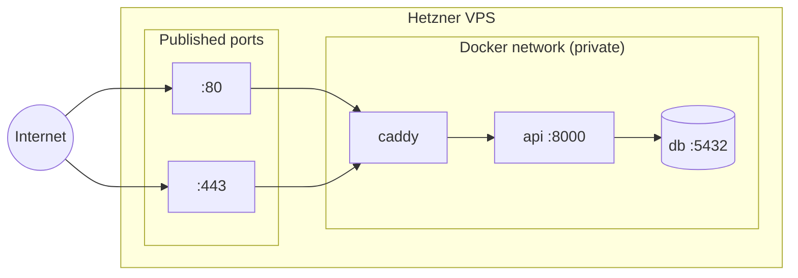

# Request Flow

A step-by-step trace of what happens when a client books an appointment, from the first tap to the database and back.

## Domain layout

The domain (e.g. `tzamot.co.il`) is the single entry point. DNS is managed by Cloudflare.

| Hostname | Points to | Serves |
|---|---|---|
| `tzamot.co.il` (root) | Cloudflare Pages | Static PWA (HTML / CSS / JS / manifest / service worker) |
| `api.tzamot.co.il` | Hetzner VPS public IP | JSON API via Caddy → FastAPI |

!!! note
    The final domain name is not chosen yet. `tzamot.co.il` is used as a placeholder throughout the docs.

## Sequence

```mermaid
sequenceDiagram
    autonumber
    actor U as User (mobile browser)
    participant CF as Cloudflare DNS / CDN
    participant P as Cloudflare Pages
    participant C as Caddy (VPS :443)
    participant A as FastAPI (VPS :8000)
    participant D as PostgreSQL (VPS :5432)

    U->>CF: GET https://tzamot.co.il
    CF->>P: route to Pages
    P-->>U: index.html, app.js, styles.css, manifest.json

    Note over U: User selects a service and date

    U->>CF: fetch GET https://api.tzamot.co.il/slots?service_id=3&date=2026-11-02
    CF-->>U: resolves to VPS IP
    U->>C: HTTPS request
    C->>C: terminate TLS (Let's Encrypt cert)
    C->>A: HTTP → api:8000 (internal docker network)
    A->>D: SELECT availability + appointments for date
    D-->>A: rows
    A->>A: compute valid slots for service duration
    A-->>C: 200 JSON [ "10:00", "10:30", … ]
    C-->>U: HTTPS response

    Note over U: User picks 10:30, enters name + phone

    U->>C: POST https://api.tzamot.co.il/appointments
    C->>A: forward
    A->>D: BEGIN; re-check slot; INSERT appointment; COMMIT
    D-->>A: ok
    A-->>U: 201 Created (via Caddy)
```

## Step by step

1. **User visits the root domain.** Cloudflare intercepts the request and serves the static frontend files from the nearest edge location. The backend is not involved at all.
2. **User interacts with the app.** JavaScript triggers `fetch()` calls to `api.tzamot.co.il`.
3. **API request reaches the subdomain.** Cloudflare DNS resolves it to the Hetzner VPS's dedicated IP.
4. **Caddy receives the request** on port 443, decrypts TLS, and forwards the plain HTTP request to the `api` container on port 8000 over Docker's private network.
5. **FastAPI processes the request**, talking to the `db` container on port 5432 — also on the private network, never exposed to the internet.
6. **The response travels back** through Caddy, out to the internet, and onto the user's screen.

## Network boundaries



- **Only ports 80 and 443** are published on the VPS (80 is needed for Let's Encrypt's HTTP challenge and redirects to 443).
- `api` and `db` are reachable **only** from other containers on the compose network.
- CORS on the API must allow the frontend origin (`https://tzamot.co.il`) — configure per environment.
