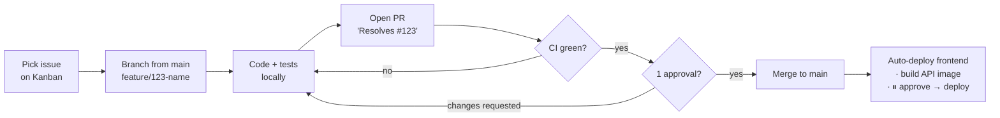

# Development Guide

!!! abstract "Source"
    Living version of the original **DevOps & Development Workflow Report**, expanded with the Sprint 1 logging requirements.

How we write, review, test, and ship code. The short version:

## Pages

| Page | What you'll learn |
|---|---|
| [Local setup](local-setup.md) | Docker Postgres + venv + uvicorn + static server on your laptop |
| [Git workflow & code review](workflow.md) | GitHub Flow, branch naming, PR rules, branch protection |
| [CI pipeline](ci-pipeline.md) | What runs on every PR: lint, format, migrate, seed, test |
| [Task management](task-management.md) | GitHub Projects Kanban and issue conventions |
| [Logging](logging.md) | Structured logs — what to log, at which level, where it goes |
| [Coding standards](coding-standards.md) | Ruff, Black, type hints, naming, tests |
| [Project structure](project-structure.md) | Repository layout — monorepo with `backend/`, `frontend/`, `infra/`, `docs/` |

## Non-negotiables

1. **Nobody pushes to `main`.** Not even the team lead. Branch → PR → review → merge.
2. **CI must be green** before merge. If it's flaky, fix the flake — don't bypass it.
3. **One approval** from the other developer is required.
4. **Schema changes ship with their Alembic migration** in the same PR.
5. **Business rules get tests** against the seeded database — see [Booking algorithm edge cases](../architecture/booking-algorithm.md#edge-cases-the-tests-must-cover).
6. **Log it.** Every state change (create / cancel / config change) emits a structured log line.
