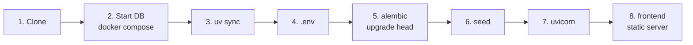

# Local Setup

!!! success "Local stack is ready"
    After the first-time steps below, use `dev-up.cmd` (Windows) or `./dev-up.sh`
    (macOS/Linux) for the daily routine. No VPS, domain, or production secrets
    are needed.

A standardised environment on every developer laptop that **mimics production without installing heavy databases on the host OS**. PostgreSQL runs in Docker; Python runs natively for fast iteration and full IDE debugging.

!!! success "Why this split?"
    Both developers use the *exact same* PostgreSQL version and configuration — no "works on my machine". Meanwhile the FastAPI process runs directly in your IDE with breakpoints, autocomplete, and `--reload`.

## Prerequisites

| Tool | Purpose | Install / check |
|---|---|---|
| **Docker Desktop** | Runs PostgreSQL locally | `docker --version` |
| **Python 3.13** | Backend runtime — [ADR-002](../decisions.md#adr-002-python-313) | `python --version` (Windows: `py -3.13 --version`) |
| **uv** | Virtual environment + dependencies — [ADR-004](../decisions.md#adr-004-uv-pyprojecttoml-for-dependencies) | `pip install uv` or [standalone installer](https://docs.astral.sh/uv/getting-started/installation/) · `uv --version` |
| **Git** | | `git --version` |
| **IDE** — VS Code or PyCharm | Python + Docker extensions; VS Code **Live Server** (or any static server) for the frontend | |

## Step by step



### 1. Clone

```bash
git clone https://github.com/hthr240/tzamot.git
cd tzamot
```

### 2. Start the database

```powershell
docker compose up -d --wait
docker compose ps
```

This starts **only PostgreSQL 16** and waits for it to be healthy. The port is
bound to `127.0.0.1:5432`, not exposed to the LAN. Database, user, and password
are all `tzamot`: fake local defaults, never production credentials.

The root [compose.yaml](https://github.com/hthr240/tzamot/blob/main/compose.yaml)
imports the [development configuration](https://github.com/hthr240/tzamot/blob/main/infra/docker-compose.dev.yml).
Run the short commands from the repository root with current Docker Desktop
and Compose `include` support. This starts the database only. Prefer
[`dev-up`](#daily-routine) when you also want migrations, the API, and the
frontend.

The configuration defines project `tzamot-dev` and named volume `pg_dev_data` (normally
`tzamot-dev_pg_dev_data`). Data survives both restarts and container recreation.
The first start downloads the image if necessary. No Python environment or
paid infrastructure is needed to run this database.

The existing explicit startup command remains compatible and uses the same
data. It is also available on Compose versions without `include`:

```powershell
docker compose -f infra\docker-compose.dev.yml up -d --wait --wait-timeout 60
```

Add `--wait-timeout 60` to the short command for an explicit startup deadline.
To connect:

```powershell
docker compose exec db psql -U tzamot -d tzamot
```

Use `\q` to exit the SQL prompt.

Pytest uses a separate database named `tzamot_test` so integration tests never
write to the developer `tzamot` database. The suite creates that database when
missing. Override the URL with `TEST_DATABASE_URL` if needed.

### 3. Python environment

```bash
cd backend
uv sync
```

`uv sync` creates `backend/.venv/`, installs everything from `uv.lock` (runtime **and** dev tools: pytest, ruff, black), and takes a few seconds.

!!! tip "Point your IDE at `backend/.venv`"
    VS Code: *Python: Select Interpreter* → `backend/.venv/bin/python` (Windows: `backend\.venv\Scripts\python.exe`). PyCharm: *Add Interpreter → Existing*. Then breakpoints and autocomplete work.

You can either prefix commands with `uv run …` (no activation needed) or activate the venv the classic way:

=== "uv run (recommended)"

    ```bash
    uv run pytest
    uv run uvicorn app.main:app --reload
    ```

=== "Activate"

    ```bash
    # Windows
    .venv\Scripts\activate
    # macOS / Linux
    source .venv/bin/activate

    pytest
    uvicorn app.main:app --reload
    ```

### 4. Environment variables

```bash
cp .env.example .env        # still inside backend/
```

The defaults match the dev compose file. **Never commit `.env`.** Keys are documented in [Environments → Configuration](../architecture/environments.md#configuration-per-environment).

### 5. Migrate

From `backend/`, apply every pending migration to the database in `DATABASE_URL`
(defaults to the local Compose Postgres):

```bash
uv run alembic upgrade head
```

Check which revision is applied:

```bash
uv run alembic current
```

You should see the latest revision id and `(head)`. Confirm the models still
match the database:

```bash
uv run alembic check
```

To wipe the schema and start over (destroys table data in that database):

```bash
uv run alembic downgrade base
uv run alembic upgrade head
```

### 6. Seed (optional but recommended)

```bash
uv run python -m scripts.seed_test_db
```

Replaces the domain tables with a fixed dataset: 5 services, two weeks of hours from Sunday 1 November 2026 (one split shift, one closed day), and four appointments. Running it again keeps the same row counts. Dates do not follow the real clock. Same script CI will use — see [CI pipeline](ci-pipeline.md#database-seeding).

### 7. Run the API

```bash
uv run uvicorn app.main:app --reload --port 8000
```

Open <http://localhost:8000/docs> — FastAPI's interactive Swagger UI. Every endpoint can be tried from there.
The initial API exposes `GET /health`; application feature routes are added in
later tickets.

The developer documentation launcher also uses port 8000. Close its Chrome
window to stop that server before starting the API, or run the documentation
manually on another port with `mkdocs serve --dev-addr 127.0.0.1:8001`.

### 8. Run the frontend

Serve the `frontend/` directory with any static server:

=== "VS Code Live Server"

    Right-click `frontend/index.html` → **Open with Live Server**. Default: <http://127.0.0.1:5500>.

=== "Python"

    ```bash
    cd frontend
    python -m http.server 5500
    ```

`frontend/js/config.js` points at `http://localhost:8000` whenever the hostname
isn't the production domain. Open <http://127.0.0.1:5500> — the client page
calls `/health` and shows the result in Hebrew. The API allows those local
origins through `CORSMiddleware` and the default `CORS_ORIGINS` list.

## Daily routine

From the repository root, one command starts PostgreSQL (waits until healthy),
runs `alembic upgrade head`, then launches the API on `:8000` and the frontend
on `:5500`:

=== "Windows"

    ```powershell
    .\dev-up.cmd
    .\dev-up.cmd --seed
    ```

=== "macOS / Linux"

    ```bash
    chmod +x dev-up.sh   # once after clone, if needed
    ./dev-up.sh
    ./dev-up.sh --seed
    ```

=== "Just (optional)"

    ```bash
    just up
    just up --seed
    just down
    ```

`--seed` runs `uv run python -m scripts.seed_test_db` after migrations.

The launcher refuses to start if port `8000` or `5500` is already taken, and it
prints a clear error if Docker or `uv` is missing. Press **Ctrl+C** to stop the
API and the frontend static server. **The database keeps running and keeps its
data.** Stop only the database with:

```powershell
docker compose down
```

That does not delete the named volume. To wipe local data, use the reset
commands below.

You can still start each piece by hand (Compose, uvicorn, Live Server) when
debugging a single layer.

## Adding a dependency

```bash
cd backend
uv add fastapi-limiter          # runtime dependency
uv add --dev freezegun          # dev-only dependency
```

This updates `pyproject.toml` **and** `uv.lock`. Commit both.

## Verify everything works

- [ ] `docker compose ps` → `healthy`
- [ ] `uv run alembic current` shows the latest revision
- [ ] <http://localhost:8000/docs> loads
- [ ] `uv run pytest` passes
- [ ] `uv run ruff check . && uv run black --check .` pass
- [ ] Frontend loads on `:5500` and shows the `/health` result without a CORS error

## Resetting

Stopping normally keeps data:

```powershell
docker compose down
```

!!! danger "Deleting local data is explicit and irreversible"
    `down --volumes` removes the local database volume. Do not run it unless
    you intend to erase that project's data. Never use a production Compose
    file or an unrelated project name for this reset.

```powershell
docker compose -p tzamot-dev down --volumes
docker compose -p tzamot-dev up -d --wait
```

After a wipe, run migrations again (and seed if you want): `.\dev-up.cmd --seed`
or steps 5 and 6 above. See the
[infrastructure runbook](https://github.com/hthr240/tzamot/blob/main/infra/README.md)
for stop and connection commands.

## Troubleshooting

??? failure "Port 5432 already in use"
    Another service may own the port. Inspect it first; do not stop an unrelated
    process. If a port change is approved, change only the host port in
    `127.0.0.1:5433:5432` and update the future backend `DATABASE_URL` to match.

??? failure "CORS error in the browser console"
    Add your static server origin (e.g. `http://127.0.0.1:5500`) to `CORS_ORIGINS` in `.env` and restart uvicorn.

??? failure "`alembic upgrade head` can't connect"
    Check `DATABASE_URL` in `.env` and that the DB container is healthy. On Windows, make sure Docker Desktop is running.

??? failure "`uv sync` says the lockfile is out of date"
    Someone changed `pyproject.toml` without re-locking. Run `uv lock` and commit `uv.lock` — or pull if a teammate already did.
