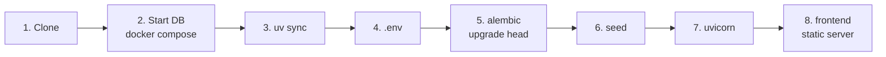

# Local Setup

!!! warning "Target setup — implementation is still in Sprint 1"
    The backend, frontend, Compose file, and launcher are not implemented yet.
    The instructions below describe the acceptance target for the infra tickets,
    not commands that already work on the documentation-only repository.
    No VPS, domain, or production secrets are needed.

A standardised environment on every developer laptop that **mimics production without installing heavy databases on the host OS**. PostgreSQL runs in Docker; Python runs natively for fast iteration and full IDE debugging.

!!! success "Why this split?"
    Both developers use the *exact same* PostgreSQL version and configuration — no "works on my machine". Meanwhile the FastAPI process runs directly in your IDE with breakpoints, autocomplete, and `--reload`.

## Prerequisites

| Tool | Purpose | Install / check |
|---|---|---|
| **Docker Desktop** | Runs PostgreSQL locally | `docker --version` |
| **Python 3.13** | Backend runtime — [ADR-002](../decisions.md#adr-002-python-313) | `python --version` (Windows: `py -3.13 --version`) |
| **uv** | Virtual environment + dependencies — [ADR-004](../decisions.md#adr-004-uv-pyprojecttoml-for-dependencies) | `pip install uv` or [standalone installer](https://docs.astral.sh/uv/getting-started/installation/) · `uv --version` |
| **Git** | | `git --version` |
| **IDE** — VS Code or PyCharm | Python + Docker extensions; VS Code **Live Server** (or any static server) for the frontend | |

## Step by step



### 1. Clone

```bash
git clone https://github.com/hthr240/tzamot.git
cd tzamot
```

### 2. Start the database

```bash
docker compose -f infra/docker-compose.dev.yml up -d
docker compose -f infra/docker-compose.dev.yml ps      # should show db healthy
```

This starts **only** PostgreSQL, exposed on `localhost:5432`, with a named volume so your data persists between restarts.

??? example "infra/docker-compose.dev.yml (reference)"
    ```yaml
    services:
      db:
        image: postgres:16
        environment:
          POSTGRES_USER: tzamot
          POSTGRES_PASSWORD: tzamot
          POSTGRES_DB: tzamot
        ports:
          - "5432:5432"
        volumes:
          - pg_dev_data:/var/lib/postgresql/data
        healthcheck:
          test: ["CMD-SHELL", "pg_isready -U tzamot"]
          interval: 5s
          retries: 10

    volumes:
      pg_dev_data:
    ```

### 3. Python environment

```bash
cd backend
uv sync
```

`uv sync` creates `backend/.venv/`, installs everything from `uv.lock` (runtime **and** dev tools: pytest, ruff, black), and takes a few seconds.

!!! tip "Point your IDE at `backend/.venv`"
    VS Code: *Python: Select Interpreter* → `backend/.venv/bin/python` (Windows: `backend\.venv\Scripts\python.exe`). PyCharm: *Add Interpreter → Existing*. Then breakpoints and autocomplete work.

You can either prefix commands with `uv run …` (no activation needed) or activate the venv the classic way:

=== "uv run (recommended)"

    ```bash
    uv run pytest
    uv run uvicorn app.main:app --reload
    ```

=== "Activate"

    ```bash
    # Windows
    .venv\Scripts\activate
    # macOS / Linux
    source .venv/bin/activate

    pytest
    uvicorn app.main:app --reload
    ```

### 4. Environment variables

```bash
cp .env.example .env        # still inside backend/
```

The defaults match the dev compose file. **Never commit `.env`.** Keys are documented in [Environments → Configuration](../architecture/environments.md#configuration-per-environment).

### 5. Migrate

```bash
uv run alembic upgrade head
```

### 6. Seed (optional but recommended)

```bash
uv run python scripts/seed_test_db.py
```

Gives you realistic services, two weeks of availability, and a few appointments to click around with. Same script CI uses — see [CI pipeline](ci-pipeline.md#database-seeding).

### 7. Run the API

```bash
uv run uvicorn app.main:app --reload --port 8000
```

Open <http://localhost:8000/docs> — FastAPI's interactive Swagger UI. Every endpoint can be tried from there.

The developer documentation launcher also uses port 8000. Close its Chrome
window to stop that server before starting the API, or run the documentation
manually on another port with `mkdocs serve --dev-addr 127.0.0.1:8001`.

### 8. Run the frontend

Serve the `frontend/` directory with any static server:

=== "VS Code Live Server"

    Right-click `frontend/index.html` → **Open with Live Server**. Default: <http://127.0.0.1:5500>.

=== "Python"

    ```bash
    cd frontend
    python -m http.server 5500
    ```

`frontend/js/config.js` points at `http://localhost:8000` whenever the hostname isn't the production domain. The API's default `CORS_ORIGINS` already includes `http://127.0.0.1:5500` and `http://localhost:5500`.

## Daily routine

```bash
docker compose -f infra/docker-compose.dev.yml up -d    # DB (from repo root)
cd backend && uv run uvicorn app.main:app --reload       # API
# + Live Server for the frontend
```

## Adding a dependency

```bash
cd backend
uv add fastapi-limiter          # runtime dependency
uv add --dev freezegun          # dev-only dependency
```

This updates `pyproject.toml` **and** `uv.lock`. Commit both.

## Verify everything works

- [ ] `docker compose -f infra/docker-compose.dev.yml ps` → `healthy`
- [ ] `uv run alembic current` shows the latest revision
- [ ] <http://localhost:8000/docs> loads
- [ ] `uv run pytest` passes
- [ ] `uv run ruff check . && uv run black --check .` pass
- [ ] Frontend loads and lists the seeded services

## Resetting

```bash
docker compose -f infra/docker-compose.dev.yml down -v   # drops the volume = fresh DB
docker compose -f infra/docker-compose.dev.yml up -d
cd backend && uv run alembic upgrade head && uv run python scripts/seed_test_db.py
```

## Troubleshooting

??? failure "Port 5432 already in use"
    A host PostgreSQL is running. Stop it, or change the host port mapping in `infra/docker-compose.dev.yml` to `5433:5432` and update `DATABASE_URL` in `.env`.

??? failure "CORS error in the browser console"
    Add your static server origin (e.g. `http://127.0.0.1:5500`) to `CORS_ORIGINS` in `.env` and restart uvicorn.

??? failure "`alembic upgrade head` can't connect"
    Check `DATABASE_URL` in `.env` and that the DB container is healthy. On Windows, make sure Docker Desktop is running.

??? failure "`uv sync` says the lockfile is out of date"
    Someone changed `pyproject.toml` without re-locking. Run `uv lock` and commit `uv.lock` — or pull if a teammate already did.
