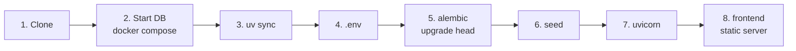

# Local Setup

!!! warning "Database and backend setup ready; the app is still planned"
    The directory scaffold, local PostgreSQL Compose setup, and locked Python
    dependencies exist. Steps 2 through 4 work now. The API, UI, migrations,
    seed data, and app launcher remain later Sprint 1 tickets. Their
    instructions below are acceptance targets, not already working app commands.
    No VPS, domain, or production secrets are needed.

A standardised environment on every developer laptop that **mimics production without installing heavy databases on the host OS**. PostgreSQL runs in Docker; Python runs natively for fast iteration and full IDE debugging.

!!! success "Why this split?"
    Both developers use the *exact same* PostgreSQL version and configuration — no "works on my machine". Meanwhile the FastAPI process runs directly in your IDE with breakpoints, autocomplete, and `--reload`.

## Prerequisites

| Tool | Purpose | Install / check |
|---|---|---|
| **Docker Desktop** | Runs PostgreSQL locally | `docker --version` |
| **Python 3.13** | Backend runtime — [ADR-002](../decisions.md#adr-002-python-313) | `python --version` (Windows: `py -3.13 --version`) |
| **uv** | Virtual environment + dependencies — [ADR-004](../decisions.md#adr-004-uv-pyprojecttoml-for-dependencies) | `pip install uv` or [standalone installer](https://docs.astral.sh/uv/getting-started/installation/) · `uv --version` |
| **Git** | | `git --version` |
| **IDE** — VS Code or PyCharm | Python + Docker extensions; VS Code **Live Server** (or any static server) for the frontend | |

## Step by step



### 1. Clone

```bash
git clone https://github.com/hthr240/tzamot.git
cd tzamot
```

### 2. Start the database

```powershell
docker compose up -d --wait
docker compose ps
```

This starts **only PostgreSQL 16** and waits for it to be healthy. The port is
bound to `127.0.0.1:5432`, not exposed to the LAN. Database, user, and password
are all `tzamot`: fake local defaults, never production credentials.

The root [compose.yaml](https://github.com/hthr240/tzamot/blob/main/compose.yaml)
imports the [development configuration](https://github.com/hthr240/tzamot/blob/main/infra/docker-compose.dev.yml).
Run the short commands from the repository root with current Docker Desktop
and Compose `include` support. This starts the database only, not the future
API/frontend launcher.

The configuration defines project `tzamot-dev` and named volume `pg_dev_data` (normally
`tzamot-dev_pg_dev_data`). Data survives both restarts and container recreation.
The first start downloads the image if necessary. No Python environment or
paid infrastructure is needed to run this database.

The existing explicit startup command remains compatible and uses the same
data. It is also available on Compose versions without `include`:

```powershell
docker compose -f infra\docker-compose.dev.yml up -d --wait --wait-timeout 60
```

Add `--wait-timeout 60` to the short command for an explicit startup deadline.
To connect:

```powershell
docker compose exec db psql -U tzamot -d tzamot
```

Use `\q` to exit the SQL prompt. The API's database session and migrations are
not implemented by this infrastructure ticket.

### 3. Python environment

```bash
cd backend
uv sync
```

`uv sync` creates `backend/.venv/`, installs everything from `uv.lock` (runtime **and** dev tools: pytest, ruff, black), and takes a few seconds.

!!! tip "Point your IDE at `backend/.venv`"
    VS Code: *Python: Select Interpreter* → `backend/.venv/bin/python` (Windows: `backend\.venv\Scripts\python.exe`). PyCharm: *Add Interpreter → Existing*. Then breakpoints and autocomplete work.

You can either prefix commands with `uv run …` (no activation needed) or activate the venv the classic way:

=== "uv run (recommended)"

    ```bash
    uv run pytest
    uv run uvicorn app.main:app --reload
    ```

=== "Activate"

    ```bash
    # Windows
    .venv\Scripts\activate
    # macOS / Linux
    source .venv/bin/activate

    pytest
    uvicorn app.main:app --reload
    ```

### 4. Environment variables

```bash
cp .env.example .env        # still inside backend/
```

The defaults match the dev compose file. **Never commit `.env`.** Keys are documented in [Environments → Configuration](../architecture/environments.md#configuration-per-environment).

### 5. Migrate

```bash
uv run alembic upgrade head
```

### 6. Seed (optional but recommended)

```bash
uv run python scripts/seed_test_db.py
```

Gives you realistic services, two weeks of availability, and a few appointments to click around with. Same script CI uses — see [CI pipeline](ci-pipeline.md#database-seeding).

### 7. Run the API

```bash
uv run uvicorn app.main:app --reload --port 8000
```

Open <http://localhost:8000/docs> — FastAPI's interactive Swagger UI. Every endpoint can be tried from there.

The developer documentation launcher also uses port 8000. Close its Chrome
window to stop that server before starting the API, or run the documentation
manually on another port with `mkdocs serve --dev-addr 127.0.0.1:8001`.

### 8. Run the frontend

Serve the `frontend/` directory with any static server:

=== "VS Code Live Server"

    Right-click `frontend/index.html` → **Open with Live Server**. Default: <http://127.0.0.1:5500>.

=== "Python"

    ```bash
    cd frontend
    python -m http.server 5500
    ```

`frontend/js/config.js` points at `http://localhost:8000` whenever the hostname isn't the production domain. The API's default `CORS_ORIGINS` already includes `http://127.0.0.1:5500` and `http://localhost:5500`.

## Daily routine

```bash
docker compose up -d --wait
cd backend && uv run uvicorn app.main:app --reload       # API
# + Live Server for the frontend
```

## Adding a dependency

```bash
cd backend
uv add fastapi-limiter          # runtime dependency
uv add --dev freezegun          # dev-only dependency
```

This updates `pyproject.toml` **and** `uv.lock`. Commit both.

## Verify everything works

- [ ] `docker compose ps` → `healthy`
- [ ] `uv run alembic current` shows the latest revision
- [ ] <http://localhost:8000/docs> loads
- [ ] `uv run pytest` passes
- [ ] `uv run ruff check . && uv run black --check .` pass
- [ ] Frontend loads and lists the seeded services

## Resetting

Stopping normally keeps data:

```powershell
docker compose down
```

!!! danger "Deleting local data is explicit and irreversible"
    `down --volumes` removes the local database volume. Do not run it unless
    you intend to erase that project's data. Never use a production Compose
    file or an unrelated project name for this reset.

```powershell
docker compose -p tzamot-dev down --volumes
docker compose -p tzamot-dev up -d --wait
```

After migrations and seeding exist, repeat steps 5 and 6 after a reset.
Those backend commands are still planned. See the
[infrastructure runbook](https://github.com/hthr240/tzamot/blob/main/infra/README.md)
for stop and connection commands.

## Troubleshooting

??? failure "Port 5432 already in use"
    Another service may own the port. Inspect it first; do not stop an unrelated
    process. If a port change is approved, change only the host port in
    `127.0.0.1:5433:5432` and update the future backend `DATABASE_URL` to match.

??? failure "CORS error in the browser console"
    Add your static server origin (e.g. `http://127.0.0.1:5500`) to `CORS_ORIGINS` in `.env` and restart uvicorn.

??? failure "`alembic upgrade head` can't connect"
    Check `DATABASE_URL` in `.env` and that the DB container is healthy. On Windows, make sure Docker Desktop is running.

??? failure "`uv sync` says the lockfile is out of date"
    Someone changed `pyproject.toml` without re-locking. Run `uv lock` and commit `uv.lock` — or pull if a teammate already did.
