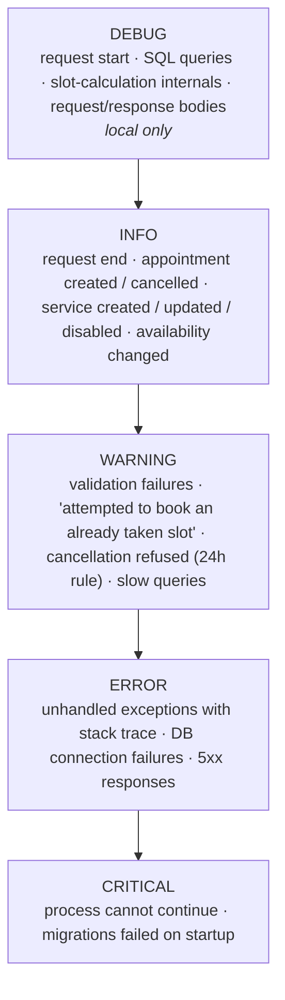

# Logging

A robust, structured logging system is a **Sprint 1 deliverable**. In production we only have Docker logs — if it isn't logged, it didn't happen.

## Goals

| Goal | How |
|---|---|
| Trace any API request end to end | A **request id** attached to every log line of that request |
| Understand what the system did | **INFO** logs for every state change and business decision |
| Debug locally without a debugger | **DEBUG** logs for DB queries and algorithm internals, off in production |
| Never lose a failure | **ERROR / CRITICAL** with **full stack traces** for unhandled exceptions |
| Readable in Docker | Write to **stdout / stderr** only — no log files inside containers |

## Library

Use Python's standard-library **`logging`** package, as decided in
[ADR-010](../decisions.md#adr-010-standard-library-logging). It works directly
with Uvicorn, SQLAlchemy, and Alembic and adds no runtime dependency.

Configuration belongs in one application module using
`logging.config.dictConfig`. Other modules obtain a named logger with
`logging.getLogger(__name__)`; they do not add handlers or configure formatting.
Ticket #14 implements shared configuration and request context. Ticket #15
adds full traceback logging and consistent JSON errors for unexpected failures.

## Request logging

Logging is configured when the API starts, using `LOG_LEVEL` from settings.
Each HTTP request gets a new UUID. Route responses include it in the
`X-Request-ID` header. Caller-provided IDs are not reused. The same ID is available as
`request.state.request_id` inside a route.

`request.started` is logged at DEBUG. `request.completed` is logged at INFO
with method, path, response status, and elapsed milliseconds. Timing covers
response processing, including streaming and background work; it is not just
the time taken to receive response headers. Unexpected exceptions produce a
`request.failed` event and an ERROR-level `request.unhandled_exception` record
with the full traceback.

Use a named logger in application code:

```python
import logging

logger = logging.getLogger(__name__)
logger.info("service.created id=%s", service_id)
```

The console handler attaches the current request ID automatically. It uses a
`ContextVar` (a value kept separate for each running request), so simultaneous
requests do not mix their IDs. Logs outside an HTTP request use `req=-`.
Uvicorn records use the same handler and are not duplicated.

## Levels



| Environment | `LOG_LEVEL` |
|---|---|
| Local | `DEBUG` |
| CI | `INFO` |
| Staging / Production | `INFO` |

### Unexpected errors

The global handler in `app/core/errors.py` catches unexpected HTTP failures.
Before a response has started, it returns HTTP 500 with a generic message:

```json
{"detail": "Internal server error", "request_id": "<id>"}
```

The ID matches both `X-Request-ID` and the ERROR log's `req=<id>`. Exception
messages and tracebacks stay in server logs, not the client response, in both
local and production environments. Use this ID to find the cause of a reported
failure.

Expected errors still use FastAPI's built-in handling: `HTTPException` keeps
its status, detail, and headers; request validation errors remain HTTP 422.
Developers should not catch unexpected bugs just to return a successful result.

If a streaming response or background task fails after headers were sent,
the handler logs the traceback but cannot replace that response with a 500.
Starlette re-raises server exceptions after handling; Uvicorn may also emit
its own traceback. In tests, use `TestClient(..., raise_server_exceptions=False)`
to inspect the HTTP response instead of having the original exception raised.

## Format

Structured key=value so lines are both human-readable and greppable:

```
2026-11-02 10:31:07.412 | INFO     | req=7f3a9c | request.completed method=GET path=/health status=200 duration_ms=3.000
2026-11-02 10:31:07.412 | INFO     | req=7f3a9c | appointment.created id=184 service_id=3 starts_at=2026-11-05T10:30+02:00 client_phone=05******12
2026-11-02 10:31:09.001 | WARNING  | req=81bb02 | booking.conflict service_id=3 starts_at=2026-11-05T10:30+02:00 reason="slot already taken"
2026-11-02 10:31:12.550 | ERROR    | req=9d10e4 | request.unhandled_exception method=GET path=/example
Traceback (most recent call last):
  ...
```

Conventions:

- **Event names** are dotted `noun.verb`: `appointment.created`, `appointment.cancelled`, `service.created`, `service.disabled`, `availability.updated`, `booking.conflict`, `cancellation.refused`.
- **Always include ids** (`id=`, `service_id=`, `appointment_id=`) so you can join log lines to DB rows.
- **Mask personal data**: never log full phone numbers or names at INFO level in production. `05******12` is enough to correlate.

## What must be logged (from the roadmap)

- [x] Request start/end with method, path, status, duration — #14
- [ ] Service **created** and **deleted / disabled** — Sprint 2
- [ ] Booking process **start** and **end** — Sprint 3
- [ ] Booking **validation failures** — e.g. *"User attempted to book an already taken slot"* — Sprint 3
- [ ] Cancellation **refused** by the 24 h rule — Sprint 4
- [ ] Admin **cancelled** a client's appointment — Sprint 2–3
- [x] **Unhandled HTTP exceptions** with full traceback and correlated JSON errors — #15

## Viewing logs

| Where | Command |
|---|---|
| Local | Your terminal running uvicorn |
| Production | `docker compose logs -f api` on the VPS |
| Production, last hour, errors only | `docker compose logs --since 1h api \| grep -E "ERROR\|CRITICAL"` |

Centralised log shipping (Loki, Betterstack, …) is **out of scope** for the MVP. Docker's default `json-file` driver with rotation (`max-size`, `max-file`) is enough — configure it in `docker-compose.prod.yml` so the disk doesn't fill.
