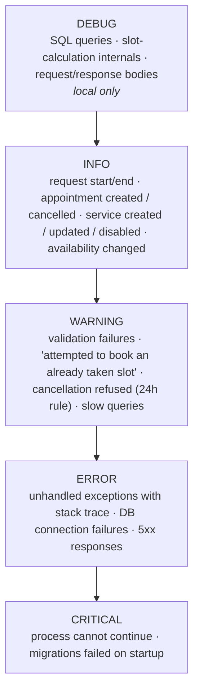

# Logging

A robust, structured logging system is a **Sprint 1 deliverable**. In production we only have Docker logs — if it isn't logged, it didn't happen.

## Goals

| Goal | How |
|---|---|
| Trace any API request end to end | A **request id** attached to every log line of that request |
| Understand what the system did | **INFO** logs for every state change and business decision |
| Debug locally without a debugger | **DEBUG** logs for DB queries and algorithm internals, off in production |
| Never lose a failure | **ERROR / CRITICAL** with **full stack traces** for unhandled exceptions |
| Readable in Docker | Write to **stdout / stderr** only — no log files inside containers |

## Library

`loguru` (recommended for its simplicity) or the standard library `logging` — decide in Sprint 1. Either way the output format and levels below are the contract.

## Levels



| Environment | `LOG_LEVEL` |
|---|---|
| Local | `DEBUG` |
| CI | `INFO` |
| Staging / Production | `INFO` |

## Format

Structured key=value (or JSON) so lines are both human-readable and greppable:

```
2026-11-02 10:31:07.412 | INFO     | req=7f3a9c | appointment.created id=184 service_id=3 starts_at=2026-11-05T10:30+02:00 client_phone=05******12
2026-11-02 10:31:09.001 | WARNING  | req=81bb02 | booking.conflict service_id=3 starts_at=2026-11-05T10:30+02:00 reason="slot already taken"
2026-11-02 10:31:12.550 | ERROR    | req=9d10e4 | unhandled exception
Traceback (most recent call last):
  ...
```

Conventions:

- **Event names** are dotted `noun.verb`: `appointment.created`, `appointment.cancelled`, `service.created`, `service.disabled`, `availability.updated`, `booking.conflict`, `cancellation.refused`.
- **Always include ids** (`id=`, `service_id=`, `appointment_id=`) so you can join log lines to DB rows.
- **Mask personal data**: never log full phone numbers or names at INFO level in production. `05******12` is enough to correlate.

## What must be logged (from the roadmap)

- [ ] Request start/end with method, path, status, duration (middleware)
- [ ] Service **created** and **deleted / disabled** — Sprint 2
- [ ] Booking process **start** and **end** — Sprint 3
- [ ] Booking **validation failures** — e.g. *"User attempted to book an already taken slot"* — Sprint 3
- [ ] Cancellation **refused** by the 24 h rule — Sprint 4
- [ ] Admin **cancelled** a client's appointment — Sprint 2–3
- [ ] **Unhandled exceptions** with full traceback (global exception handler)

## Viewing logs

| Where | Command |
|---|---|
| Local | Your terminal running uvicorn |
| Production | `docker compose logs -f api` on the VPS |
| Production, last hour, errors only | `docker compose logs --since 1h api \| grep -E "ERROR\|CRITICAL"` |

Centralised log shipping (Loki, Betterstack, …) is **out of scope** for the MVP. Docker's default `json-file` driver with rotation (`max-size`, `max-file`) is enough — configure it in `docker-compose.prod.yml` so the disk doesn't fill.
