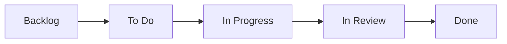

# Task Management

We track work with GitHub Issues, Milestones, and the
[Tzamot project](https://github.com/users/hthr240/projects/3), linked to the repository.
Code, tasks, and discussion stay on the same platform. The project is private;
repository access and project access are separate.

## Jira concepts in GitHub

| Jira concept | Our GitHub equivalent |
|---|---|
| Sprint | A milestone with a goal. Sprint 1–4 exist; no fixed due dates yet. |
| User story | An issue labelled `story`, with acceptance criteria and task sub-issues. |
| Task / sub-task | An issue labelled `task`, linked to its parent story. |
| Bug | An issue labelled `bug`, with reproduction steps and expected behavior. |
| Epic | An optional higher-level parent issue; not a separate layer in Sprint 1. |
| Component | An area label such as `backend` or `infra`. |
| Board | A Project view grouped into Status columns. |
| Estimate | The Project's `Estimate` field, in approximate developer-days, not story points. |

This personal repository uses labels, not organization-only issue types.
Stories describe outcomes; tasks describe the small changes needed to achieve them.
Milestone completion is an issue-count percentage, **not a burndown chart**.
It counts both parent stories and their tasks.

## The board



| Column | Meaning | Who moves cards here |
|---|---|---|
| **Backlog** | Newly added or not selected for work. May already have a milestone. | Item-added automation |
| **To Do** | Scoped but not started. Check prerequisites before picking it up. | Team lead / developer |
| **In Progress** | Assigned and actively being worked on. **One active task per developer.** | Developer |
| **In Review** | PR or configuration work is ready for approval. | Developer, manually |
| **Done** | Code merged to `main`, or non-code work verified and closed. | Issue-closed automation |

Parent stories may be In Progress while their tasks move independently.
Do not close a story just because one task merged.

### Views and automation

| View | Purpose |
|---|---|
| **Board** | Issues across milestones, in Status columns |
| **Sprint 1** | Sprint 1 issues, in Status columns and grouped by parent story |
| **Backlog** | Open issues with no milestone; currently it may be empty |

**Milestone membership and Status are independent.** For example, an issue can
belong to Sprint 1 while its Status is Backlog. The Backlog *view* instead filters
for issues with no milestone. Views show issues, avoiding duplicate PR cards.

Auto-add, item-added, issue-closed, and issue-reopened behavior has been tested:
new issues enter Backlog, closing moves them to Done, and reopening moves them
to To Do. Sub-issue auto-add and PR-merged workflows are also enabled.
PR-linked In Review automation is disabled, so move the issue there manually.
Auto-close is enabled too; only use Done for genuinely completed work.

## Issue conventions

Break the MVP into **actionable issues**: small enough to finish in 1–2 days, specific enough that "done" is unambiguous.

| | Good | Too vague |
|---|---|---|
| Title | "Create `services` table + Alembic migration" | "Database stuff" |
| Title | "Implement `/slots` endpoint with overlap filtering" | "Booking" |
| Body | Acceptance criteria as a checklist, link to relevant docs page | Empty |

### Issue template

```markdown
## What
One or two sentences.

## Acceptance criteria
- [ ] …
- [ ] Tests cover …
- [ ] Log events for …

## Docs
Link to the relevant page, e.g. docs/architecture/booking-algorithm.md
```

### Labels

| Label | Use |
|---|---|
| `story` · `task` · `bug` | Kind of work |
| `backend` · `frontend` · `infra` · `ci` · `docs` · `pm` | Area; `pm` means project management |
| `good first issue` | Suitable for a newly onboarded developer |

Use milestones instead of `sprint-N` labels. Set a task's milestone explicitly;
do not assume it inherits the parent's milestone. Use native **blocked by**
relationships for prerequisites, and leave future tasks unassigned.

## Linking PRs to issues

Put `Resolves #<task-number>` (or `Closes #`, `Fixes #`) in the PR description.
When the PR merges into the default branch (`main`), GitHub closes the linked
task and the issue-closed workflow moves it to Done. Do not link the whole story
unless the PR actually completes it.

Configuration-only tasks can be closed manually after their acceptance criteria
are verified; they do not need an empty branch or PR. See the
[Git workflow](workflow.md) for the code-change path.

## Sprint rhythm

- **Planning** — give stories and tasks a milestone, write acceptance criteria,
  add prerequisite links, and select work into To Do.
- **Daily** — pick one unblocked task, assign yourself, implement and validate,
  open a PR, move to In Review, obtain the agreed approval, then merge.
- **Review** — demonstrate the milestone goal, close completed stories, and
  explicitly move unfinished work to the next milestone or unscheduled backlog.

Sprint 1 has no fixed deadline. Close its milestone only when its goal and
required work are complete. Backend, frontend, and local infrastructure come
first; no VPS or domain purchase is needed before MVP readiness.

## Issue and PR templates

**Issues → New issue** offers three forms once the templates are merged to `main`:

- **User story** applies the `story` label and asks for the goal and acceptance criteria.
- **Task** applies the `task` label and asks for scope, acceptance criteria, and dependencies.
- **Bug report** applies the `bug` label and asks for reproduction steps, expected and actual behavior, environment, and fix criteria.

All forms include a documentation field. Set the area label, milestone, project,
and parent relationship separately; these are not inferred from the form.
Leave future tasks unassigned until someone starts them.

The [issue forms](https://github.com/hthr240/tzamot/tree/main/.github/ISSUE_TEMPLATE)
and [PR template](https://github.com/hthr240/tzamot/blob/main/.github/PULL_REQUEST_TEMPLATE.md)
live in `.github/`. The PR template asks for the linked task, validation results,
tests, migrations, logging, and documentation. Explain non-applicable checks
instead of claiming that unavailable backend tools were run.
