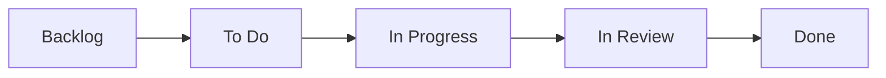

# Task Management

We track work with GitHub Issues, Milestones, and the
[Tzamot project](https://github.com/users/hthr240/projects/3), linked to the repository.
Code, tasks, and discussion stay on the same platform. The project is private;
repository access and project access are separate.

## Jira concepts in GitHub

| Jira concept | Our GitHub equivalent |
|---|---|
| Sprint | A milestone with a goal. Sprint 1–4 exist; no fixed due dates yet. |
| User story | An issue labelled `story`, with acceptance criteria and task sub-issues. |
| Task / sub-task | An issue labelled `task`, linked to its parent story. |
| Bug | An issue labelled `bug`, with reproduction steps and expected behavior. |
| Epic | An optional higher-level parent issue; not used as a separate layer for the MVP. |
| Component | An area label such as `backend` or `infra`. |
| Board | A Project view grouped into Status columns. |
| Estimate | The Project's `Estimate` field, in approximate developer-days, not story points. |

This personal repository uses labels, not organization-only issue types.
Stories describe outcomes; tasks describe the small changes needed to achieve them.
Milestone completion is an issue-count percentage, **not a burndown chart**.
It counts both parent stories and their tasks.

## The board



| Column | Meaning | Who moves cards here |
|---|---|---|
| **Backlog** | Newly added or not selected for work. May already have a milestone. | Item-added automation |
| **To Do** | Scoped but not started. Check prerequisites before picking it up. | Team lead / developer |
| **In Progress** | Assigned and actively being worked on. **One active task per developer.** | Developer |
| **In Review** | PR or configuration work is ready for approval. | Developer, manually |
| **Done** | Code merged to `main`, or non-code work verified and closed. | Issue-closed automation |

Parent stories may be In Progress while their tasks move independently.
Do not close a story just because one task merged. Close the story only when its
acceptance criteria and required sub-issues are done.

### Views and automation

| View | Purpose |
|---|---|
| **Board** | Issues across milestones, in Status columns |
| **Sprint 2** | Active sprint board — Status columns, grouped by parent story |
| **Sprint 1 (done)** | Historical Sprint 1 board |
| **Backlog** | Open issues with no milestone; currently it may be empty |
| **Work queue** | Open Sprint 2 `task` issues in `Execution order`, without parent-story grouping |

**Milestone membership and Status are independent.** For example, an issue can
belong to Sprint 2 while its Status is Backlog. The Backlog *view* instead filters
for issues with no milestone. Views show issues, avoiding duplicate PR cards.

**Stories on the Sprint 2 board:** keep parent stories visible (To Do / In Progress).
Group the view by **Parent issue**. Move only **tasks** through
In Progress → In Review → Done. When the first task of a story starts, move that
story to In Progress. When the last required task closes, close the story.

Auto-add, item-added, issue-closed, and issue-reopened behavior has been tested:
new issues enter Backlog, closing moves them to Done, and reopening moves them
to To Do. Sub-issue auto-add and PR-merged workflows are also enabled.
PR-linked In Review automation is disabled, so move the issue there manually.
Auto-close is enabled too; only use Done for genuinely completed work.

### Execution order

Start from the [Work queue](https://github.com/users/hthr240/projects/3/views/5)
(or the [Sprint 2](https://github.com/users/hthr240/projects/3/views/7) board).
Its `Execution order` number mirrors the manual row order. It is not the issue
number, estimate, or an automatically calculated priority. Sort the Work queue
table by **Execution order** ascending. Completed tasks disappear from this view
but keep their number.

Sprint 1 is complete (historical orders 1–21). Sprint 2 work queue:

| Execution order | Task |
|---|---|
| 1 | #62 — admin `ADMIN_TOKEN` bearer auth for `/admin/*` *(done)* |
| 2 | #63 — services CRUD API, active-only list, logging, tests *(next)* |
| 3 | #64 — availability windows API |
| 4 | #65 — weekly confirmation and single-day materialised edits |
| 5 | #66 — `api.js` loading indicator and Hebrew error mapping |
| 6 | #67 — admin UI base layout (mobile-first RTL) |
| 7 | #68 — admin services UI |
| 8 | #69 — admin availability week UI |
| 9 | #70 — admin daily/weekly schedule views (empty until Sprint 3) |

This sequence respects native prerequisite links. Do not invent dependencies
just to force this order. Ask before changing the plan, then update both the
number field and manual row order. New issues are not automatically ranked.
Finish and review one task before starting the next; the assistant explains
each phase and waits for approval as described in the [workflow](workflow.md#approval-before-work).

## Issue conventions

Break the MVP into **actionable issues**: small enough to finish in 1–2 days, specific enough that "done" is unambiguous.

| | Good | Too vague |
|---|---|---|
| Title | "Create `services` table + Alembic migration" | "Database stuff" |
| Title | "Implement `/slots` endpoint with overlap filtering" | "Booking" |
| Body | Acceptance criteria as a checklist, link to relevant docs page | Empty |

### Issue template

```markdown
## What
One or two sentences.

## Acceptance criteria
- [ ] …
- [ ] Tests cover …
- [ ] Log events for …

## Docs
Link to the relevant page, e.g. docs/architecture/booking-algorithm.md
```

### Labels

| Label | Use |
|---|---|
| `story` · `task` · `bug` | Kind of work |
| `backend` · `frontend` · `infra` · `ci` · `docs` · `pm` | Area; `pm` means project management |
| `good first issue` | Suitable for a newly onboarded developer |

Use milestones instead of `sprint-N` labels. Set a task's milestone explicitly;
do not assume it inherits the parent's milestone. Use native **blocked by**
relationships for prerequisites, and leave future tasks unassigned.

## Linking PRs to issues

Put `Resolves #<task-number>` (or `Closes #`, `Fixes #`) in the PR description.
When the PR merges into the default branch (`main`), GitHub closes the linked
task and the issue-closed workflow moves it to Done. Do not link the whole story
unless the PR actually completes it.

Configuration-only tasks can be closed manually after their acceptance criteria
are verified; they do not need an empty branch or PR. See the
[Git workflow](workflow.md) for the code-change path.

## Sprint rhythm

- **Planning** — give stories and tasks a milestone, write acceptance criteria,
  add prerequisite links, and select work into To Do.
- **Daily** — pick one unblocked task, assign yourself, implement and validate,
  open a PR, move to In Review, obtain the agreed approval, then merge.
- **Review** — demonstrate the milestone goal, close completed stories, and
  explicitly move unfinished work to the next milestone or unscheduled backlog.

Sprint milestones have no fixed deadline. Close a milestone only when its goal
and required work are complete. Sprint 1 is closed. Backend, frontend, and
local infrastructure come before any VPS or domain purchase.

### Mid-sprint discoveries

When a defect or gap appears while working a planned ticket, and it is **not**
part of that ticket's acceptance criteria, do not hide it inside the original
issue or rename the branch to the next queue item.

1. Open a new issue with the matching kind label (`bug` when something is
   broken, otherwise `task`).
2. Set the area label, the current sprint milestone, and the Tzamot project.
3. Write reproduction steps or a clear scope, plus acceptance criteria.
4. Link the planned ticket it came from (for example "found after #24").
5. Put the new issue on the board. Decide whether it blocks the next planned
   ticket before continuing the work queue.
6. Branch and open the PR against **that** new issue number, not the original
   planned ticket and not the next queue item.

This rule applies in every sprint. Example: [#51](https://github.com/hthr240/tzamot/issues/51)
covers CI failures found after #24 closed.

## Issue and PR templates

**Issues → New issue** offers three forms once the templates are merged to `main`:

- **User story** applies the `story` label and asks for the goal and acceptance criteria.
- **Task** applies the `task` label and asks for scope, acceptance criteria, and dependencies.
- **Bug report** applies the `bug` label and asks for reproduction steps, expected and actual behavior, environment, and fix criteria.

All forms include a documentation field. Set the area label, milestone, project,
and parent relationship separately; these are not inferred from the form.
Leave future tasks unassigned until someone starts them.

The [issue forms](https://github.com/hthr240/tzamot/tree/main/.github/ISSUE_TEMPLATE)
and [PR template](https://github.com/hthr240/tzamot/blob/main/.github/PULL_REQUEST_TEMPLATE.md)
live in `.github/`. The PR template asks for the linked task, validation results,
tests, migrations, logging, and documentation. Explain non-applicable checks
instead of claiming that unavailable backend tools were run.
