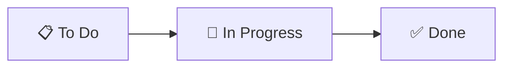

# Task Management

We track work with **GitHub Projects** — a Kanban board living inside the repository. Code, tasks, and discussion all happen on the same platform with zero context switching.

## The board



| Column | Meaning | Who moves cards here |
|---|---|---|
| **To Do** | Ready to pick up. Clearly scoped, acceptance criteria written. | Team lead (during sprint planning) |
| **In Progress** | Someone is actively working on it. **One or two per person max.** | The developer, when they start |
| **Done** | Merged to `main`. | GitHub — automatically, when a PR with `Resolves #N` merges |

## Issue conventions

Break the MVP into **actionable issues**: small enough to finish in 1–2 days, specific enough that "done" is unambiguous.

| | Good | Too vague |
|---|---|---|
| Title | "Create `services` table + Alembic migration" | "Database stuff" |
| Title | "Implement `/slots` endpoint with overlap filtering" | "Booking" |
| Body | Acceptance criteria as a checklist, link to relevant docs page | Empty |

### Issue template

```markdown
## What
One or two sentences.

## Acceptance criteria
- [ ] …
- [ ] Tests cover …
- [ ] Log events for …

## Docs
Link to the relevant page, e.g. docs/architecture/booking-algorithm.md
```

### Labels

| Label | Use |
|---|---|
| `backend` · `frontend` · `infra` · `docs` | Area |
| `sprint-1` … `sprint-4` | Roadmap sprint — see [Roadmap](../roadmap/index.md) |
| `bug` | Something broken on `main` |
| `good first issue` | Suitable for a newly onboarded developer |

## Linking PRs to issues

Put `Resolves #<number>` (or `Closes #`, `Fixes #`) in the PR description. When the PR merges, GitHub closes the issue and moves the card to **Done**.

## Sprint rhythm

- **Sprint planning** — team lead fills **To Do** from the current [sprint page](../roadmap/index.md).
- **Daily** — a 2-line async update is enough for two people: *what I did, what's blocking me*.
- **Sprint review** — demo on a phone, move leftovers to the next sprint, update the roadmap checklists.

## Issue and PR templates

**Issues → New issue** offers three forms once the templates are merged to `main`:

- **User story** applies the `story` label and asks for the goal and acceptance criteria.
- **Task** applies the `task` label and asks for scope, acceptance criteria, and dependencies.
- **Bug report** applies the `bug` label and asks for reproduction steps, expected and actual behavior, environment, and fix criteria.

All forms include a documentation field. Set the area label, milestone, project,
and parent relationship separately; these are not inferred from the form.
Leave future tasks unassigned until someone starts them.

The [issue forms](https://github.com/hthr240/tzamot/tree/main/.github/ISSUE_TEMPLATE)
and [PR template](https://github.com/hthr240/tzamot/blob/main/.github/PULL_REQUEST_TEMPLATE.md)
live in `.github/`. The PR template asks for the linked task, validation results,
tests, migrations, logging, and documentation. Explain non-applicable checks
instead of claiming that unavailable backend tools were run.
