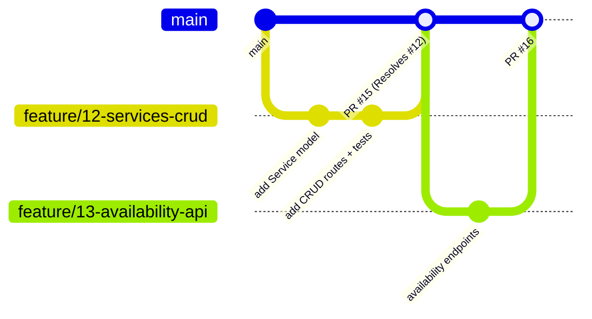

# Git Workflow & Code Review

We use **GitHub Flow**: one long-lived branch (`main`), short-lived feature branches, pull requests for everything.

Code changes go through PRs. Verified non-code configuration tasks can close
without a PR. These are team working rules; branch protection is still pending
in [#25](https://github.com/hthr240/tzamot/issues/25).

## The flow



1. **Pick one task**, read its acceptance criteria and blocked-by links, assign
   yourself, and move it to **In Progress**.
2. **Branch from `main`**:
   ```powershell
   git switch main
   git pull --ff-only
   git switch -c chore/6-project-skeleton
   ```
   Stop if synchronization fails; do not overwrite local work or force-push.
3. **Implement and validate** the ticket. Run only applicable checks: strict
   MkDocs for docs, and Ruff, Black, and pytest once the backend exists.
4. **Commit, push, and open a PR** against `main`. Include `Resolves #6` for
   this example and describe validation results.
5. **Move the issue to In Review manually.** Check any triggered CI results;
   not every file currently triggers a workflow.
6. **Obtain the agreed approval.** While solo, inspect your own diff and checks;
   agent-assisted work also waits for the user's approval. GitHub does not allow
   approving your own PR. Once another developer joins, request their review.
7. **Merge** after approval and applicable checks pass. Confirm that the task
   closes and moves to Done. Delete the merged branch and sync `main` before
   starting the next task. Close the parent story only when all its criteria hold.

## Branch naming

| Prefix | Use | Example |
|---|---|---|
| `feature/` | New functionality | `feature/23-slot-calculation` |
| `fix/` | Bug fix | `fix/41-cancel-24h-off-by-one` |
| `chore/` | Tooling, deps, CI, docs | `chore/7-add-ruff-config` |

Format: `<prefix>/<issue-number>-<short-kebab-description>`.

## Commit messages

Short imperative subject line (≤ 72 chars), optional body explaining *why*:

```
Add exclusion constraint to prevent overlapping appointments

Defence in depth for the race condition between slot listing and
booking. The application layer still re-validates, but the DB now
guarantees it.
```

## Pull request checklist

Use the [PR template](https://github.com/hthr240/tzamot/blob/main/.github/PULL_REQUEST_TEMPLATE.md).
It links the task and checks tests, migrations, logging, docs, and applicable
validation commands. Explain non-applicable checks; do not claim that backend
tests ran before the backend exists.

## Code review guidelines

**For the author**

- Keep PRs small — ideally reviewable in < 15 minutes.
- Explain *why* in the description, not just *what*.
- Respond to every comment (fix, or explain why not).

**For the reviewer**

- Review within one working day.
- Check: does it match the [business rules](../product/business-rules.md)? Is it tested? Is it logged? Will *you* be able to maintain it?
- Prefer questions over commands. Mark nits as `nit:`.
- Approve when it's *good enough and safe*, not perfect.

!!! info "Solo now, peer review later"
    Solo development uses PRs and explicit approval without requiring a second
    person's GitHub review. With two developers, require one peer approval to
    share knowledge and catch bugs. Under that policy an unavailable reviewer
    means waiting, not silently bypassing protection.

## Branch protection on `main`

The repository is **public**, but `main` is **not protected yet**. Anyone can
read or fork public code; only authorized collaborators can push to this
repository or merge its PRs. The private Project has separate access controls.

The approved policy is implemented separately in
[#25](https://github.com/hthr240/tzamot/issues/25), under repository
**Settings → Branches / Rules → main**:

| Setting | Initial solo policy | Later |
|---|---|---|
| Require PRs before merging | Yes, including administrators | Keep |
| Required peer approvals | Zero; self-approval is not possible | One when the second developer joins |
| Force-push and branch deletion | Block | Keep |
| Required backend check | None until backend CI exists | Configure through [#31](https://github.com/hthr240/tzamot/issues/31), after #24 |
| Admin bypass | Disabled | Keep |

Do not require the path-filtered **Docs** workflow on every PR: files outside
its paths do not trigger it. Before making a backend check required, ensure it
reports a result on every PR, including docs-only changes. See the
[CI pipeline](ci-pipeline.md) for that distinction.
