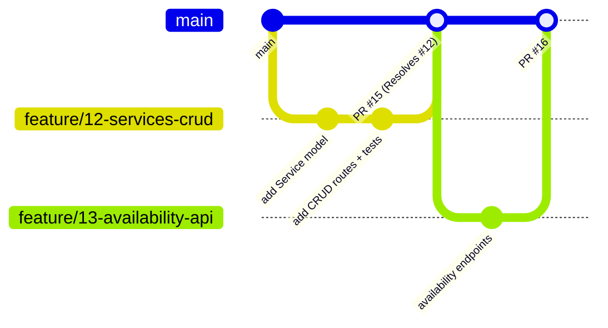

# Git Workflow & Code Review

We use **GitHub Flow**: one long-lived branch (`main`), short-lived feature branches, pull requests for everything.

## The flow



1. **Pick an issue** on the Kanban board and assign yourself. Move it to **In Progress**.
2. **Branch from `main`**:
   ```bash
   git checkout main && git pull
   git checkout -b feature/12-services-crud
   ```
3. **Commit** small, focused changes. Run `ruff`, `black`, and `pytest` locally before pushing.
4. **Push and open a PR** against `main`. Include `Resolves #12` in the description.
5. **CI runs** automatically — see [CI pipeline](ci-pipeline.md). Fix anything red.
6. **The other developer reviews.** Address comments, push fixes.
7. **Merge** once approved and green. Delete the branch. GitHub moves the issue to **Done**.

## Branch naming

| Prefix | Use | Example |
|---|---|---|
| `feature/` | New functionality | `feature/23-slot-calculation` |
| `fix/` | Bug fix | `fix/41-cancel-24h-off-by-one` |
| `chore/` | Tooling, deps, CI, docs | `chore/7-add-ruff-config` |

Format: `<prefix>/<issue-number>-<short-kebab-description>`.

## Commit messages

Short imperative subject line (≤ 72 chars), optional body explaining *why*:

```
Add exclusion constraint to prevent overlapping appointments

Defence in depth for the race condition between slot listing and
booking. The application layer still re-validates, but the DB now
guarantees it.
```

## Pull request checklist

Copy into the PR description (a template will live in `.github/PULL_REQUEST_TEMPLATE.md`):

- [ ] `Resolves #<issue>` linked
- [ ] Tests added / updated for any business rule touched
- [ ] Alembic migration included if models changed
- [ ] Log events added for new state changes
- [ ] Docs updated if behaviour, setup, or API changed
- [ ] Ran `ruff check .`, `black --check .`, `pytest` locally

## Code review guidelines

**For the author**

- Keep PRs small — ideally reviewable in < 15 minutes.
- Explain *why* in the description, not just *what*.
- Respond to every comment (fix, or explain why not).

**For the reviewer**

- Review within one working day.
- Check: does it match the [business rules](../product/business-rules.md)? Is it tested? Is it logged? Will *you* be able to maintain it?
- Prefer questions over commands. Mark nits as `nit:`.
- Approve when it's *good enough and safe*, not perfect.

!!! success "Why mandatory review with only two developers?"
    It guarantees both of you understand the whole codebase, catches logic bugs early, and prevents knowledge silos. If one person is unavailable, the other can ship.

## Branch protection on `main`

Configured by the team lead under **Settings → Branches → Add rule** for `main`:

| Setting | Value |
|---|---|
| Require a pull request before merging | ✅ |
| Required approvals | **1** |
| Dismiss stale approvals when new commits are pushed | ✅ recommended |
| Require status checks to pass before merging | ✅ — select the CI job |
| Require branches to be up to date before merging | ✅ recommended |
| Do not allow bypassing the above settings | ✅ (applies to admins too) |
| Allow force pushes / deletions | ❌ |

Result: **`main` is always stable and always deployable.**
