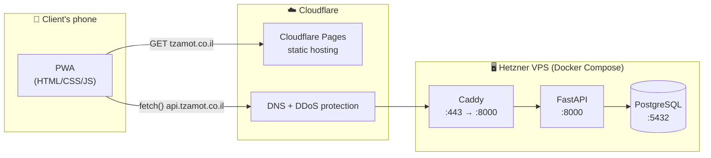

# Tzamot — Developer Documentation

**Tzamot** (צמות, Hebrew for *braids*) is a mobile-first Progressive Web App for a private braids & hair-styling business. It lets hundreds of existing clients book and cancel appointments in seconds — **without creating an account** — and gives the business owner a dynamic calendar to manage services and working hours from her phone.

!!! tip "New here?"
    Start with the [Onboarding Checklist](onboarding.md). It walks you from zero to a running local environment and your first pull request.

## The 60-second summary

| | |
|---|---|
| **Problem** | The owner schedules hundreds of clients manually. Double bookings, back-and-forth messaging, no-shows. |
| **Solution** | A booking PWA that computes available slots from the owner's real-time availability and each service's duration. |
| **Users** | **Clients** (identify by name + phone) and the **Admin** (the business owner). |
| **UI language** | Hebrew (RTL). Code, docs, and commits are in English. |
| **Backend** | Python · FastAPI · SQLAlchemy · Alembic · PostgreSQL — all in Docker |
| **Frontend** | Vanilla HTML / CSS / JS PWA on Cloudflare Pages |
| **Hosting** | Hetzner Cloud VPS (CX22) · Caddy reverse proxy with automatic HTTPS |
| **Cost** | ≈ €4.50 / month |
| **Team** | 2 developers (team lead + 1), GitHub Flow, protected `main`, CI on every PR |

## How the pieces fit together

See [Architecture](architecture/index.md) for the full breakdown and [Request Flow](architecture/request-flow.md) for a step-by-step trace.

## Where to go next

-   :material-clipboard-text: **Product**

    ---

    What we're building and why: user roles, features, business rules, and what's deliberately *not* in the MVP.

    [:octicons-arrow-right-24: Product overview](product/index.md)

-   :material-sitemap: **Architecture**

    ---

    Infrastructure, data model, the slot-calculation algorithm, deployment topology, and cost.

    [:octicons-arrow-right-24: Architecture overview](architecture/index.md)

-   :material-code-braces: **Development**

    ---

    Local setup, branching, code review, CI pipeline, logging, and coding standards.

    [:octicons-arrow-right-24: Development guide](development/index.md)

-   :material-map-marker-path: **Roadmap**

    ---

    The 4-sprint plan from an empty repo to production launch — with live checklists.

    [:octicons-arrow-right-24: MVP roadmap](roadmap/index.md)

## Guiding principles

1. **Zero friction for clients.** No accounts, no passwords. Name + phone is enough.
2. **The calendar is the source of truth.** Every slot shown is computed from real availability minus real bookings. Never show a slot that can't be booked.
3. **Mobile first, always.** The owner uses this during the workday with one hand. Clients use it from WhatsApp links.
4. **Boring, reliable infrastructure.** No cold starts, no free-tier surprises. One VPS, three containers, predictable cost.
5. **`main` is always deployable.** Protected branch, mandatory review, CI must be green.
