# Admin Features

Everything the business owner can do in the MVP. The admin UI lives on a hidden/unlisted page and is **optimised for one-handed phone use during the workday**.

## Dynamic calendar & availability management

The admin is in full control of *when* clients can book.

| Capability | Description |
|---|---|
| **Weekly working hours** | Define a default pattern — e.g. Sun–Thu 09:00–19:00, Fri 08:00–13:00, Sat closed. |
| **Per-day customisation** | Override the hours for a specific date. |
| **Split shifts** | Multiple availability windows on the same day, e.g. 09:00–13:00 **and** 16:00–20:00. |
| **Block time** | Mark whole days or specific hours as unavailable (personal time, holidays). |
| **Daily view** | What's happening today — appointments in order, client name + phone, service. |
| **Weekly view** | The week at a glance for planning. |

```mermaid
gantt
    title Example day: split shift with a blocked lunch and two bookings
    dateFormat HH:mm
    axisFormat %H:%M
    todayMarker off
    section Availability
    Morning window     :active, a1, 09:00, 4h
    Afternoon window   :active, a2, 16:00, 4h
    section Appointments
    Box braids (Dana)  :crit, b1, 09:00, 12:30
    Cornrows (Noa)     :crit, b2, 16:30, 18:00
```

Every change to availability is immediately reflected in the slots clients see — there is no publish step.

## Service configuration

Admin can **add**, **edit**, or **disable** services.

| Field | Type | Role |
|---|---|---|
| Name | text | Shown to clients |
| Price | money | Shown to clients; payment is collected on-site in the MVP |
| Duration | minutes | **Directly dictates the calendar blocking logic** — see [Business rules](business-rules.md#dynamic-time-blocking) |
| Active | boolean | Disabled services are hidden from clients but preserved for history |

!!! warning "Changing a duration"
    Editing a service's duration affects **future slot calculations only**. Existing appointments keep the end time computed at booking time. This is an implementation detail to confirm in Sprint 2.

## Appointment override & control

The admin can bypass client-facing rules when needed:

- **Manual booking on behalf of a client** — e.g. someone calls or messages. Admin picks the service, slot, and enters the client's name + phone.
- **Cancel any appointment at any time** — emergencies, schedule changes. The 24-hour rule does **not** apply to the admin.

!!! question "Should the admin be able to double-book?"
    Not in the MVP. Manual bookings go through the same slot validation as client bookings. If the owner needs an "override anyway" option later, it's a Phase 2 feature.

## Logging expectations

The admin flows emit structured log events (service created/deleted, availability changed, appointment cancelled by admin) so issues can be traced from Docker logs. See [Logging](../development/logging.md).
