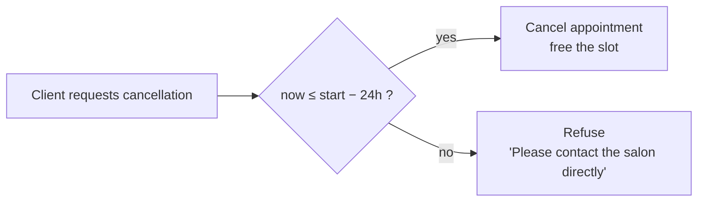

# Business Rules

These rules are the heart of the product. They must hold **in the API**, not just in the UI — the UI is only a convenience layer.

## Dynamic time blocking

> When a client books a service, the system automatically reserves **exactly** `duration_minutes` starting from the chosen slot. No other appointment may overlap that interval.

### Definitions

- An **availability window** is `[start, end)` on a given date.
- An **appointment** occupies `[start, start + duration)`.
- A **valid slot** for a service is a start time `t` such that:
    1. `[t, t + duration)` lies entirely inside one availability window, and
    2. `[t, t + duration)` does not overlap any existing (non-cancelled) appointment.

### Worked example

Availability on a given day: **09:00–13:00**. Slot granularity: 30 min (to be confirmed in Sprint 3).

=== "Empty day"

    Service: 90 min.

    | Candidate start | Fits in window? | Overlaps booking? | Valid |
    |---|:---:|:---:|:---:|
    | 09:00 | ✓ (ends 10:30) | – | ✅ |
    | 09:30 | ✓ | – | ✅ |
    | 10:00 | ✓ | – | ✅ |
    | 10:30 | ✓ | – | ✅ |
    | 11:00 | ✓ | – | ✅ |
    | 11:30 | ✓ (ends 13:00) | – | ✅ |
    | 12:00 | ✗ (ends 13:30) | – | ❌ |

=== "With one booking"

    Service: 90 min. Existing booking: **10:00–11:00**.

    | Candidate start | Fits in window? | Overlaps 10:00–11:00? | Valid |
    |---|:---:|:---:|:---:|
    | 09:00 | ✓ (ends 10:30) | ✗ overlaps | ❌ |
    | 09:30 | ✓ | ✗ overlaps | ❌ |
    | 10:00 | ✓ | ✗ overlaps | ❌ |
    | 10:30 | ✓ | ✗ overlaps | ❌ |
    | 11:00 | ✓ (ends 12:30) | – | ✅ |
    | 11:30 | ✓ (ends 13:00) | – | ✅ |
    | 12:00 | ✗ | – | ❌ |

    Only **11:00** and **11:30** are offered.

=== "Short service, same booking"

    Service: 30 min. Existing booking: **10:00–11:00**.

    Valid starts: 09:00, 09:30, 11:00, 11:30, 12:00, 12:30.

    The 09:30 slot is valid here (ends exactly at 10:00 — intervals are half-open, so touching is not overlapping).

### Guarantees

- The slot list returned to the client is **already filtered** — the client never sees an invalid slot.
- The booking endpoint **re-validates** the slot inside the same transaction before inserting, to defend against two clients booking the same slot at the same moment (race condition).
- Rejected attempts are logged: *"User attempted to book an already taken slot"*.

See [Booking algorithm](../architecture/booking-algorithm.md) for the implementation plan.

## 24-hour cancellation rule

> A client may cancel their appointment only if the current time is **at least 24 hours** before the appointment's start time.

- The check is done **server-side** using the server's clock in the business's timezone (Asia/Jerusalem).
- The **admin is exempt** — she can cancel at any time.
- A cancelled appointment immediately frees its interval for new bookings.

## Service lifecycle

- Services are **disabled, not deleted**. Historical appointments must keep referencing the service they were booked for.
- Disabled services are hidden from the client catalog and cannot be booked.

## Identity

- A client is identified by **full name + phone number**. There is no account, password, or email.
- The same phone number may appear on many appointments. There is no uniqueness constraint in the MVP (CRM/history is out of scope).

## Timezone

All business logic operates in **Asia/Jerusalem**. Store timestamps in UTC in the database; convert at the API boundary. (Convention to confirm in Sprint 1 when writing models.)
