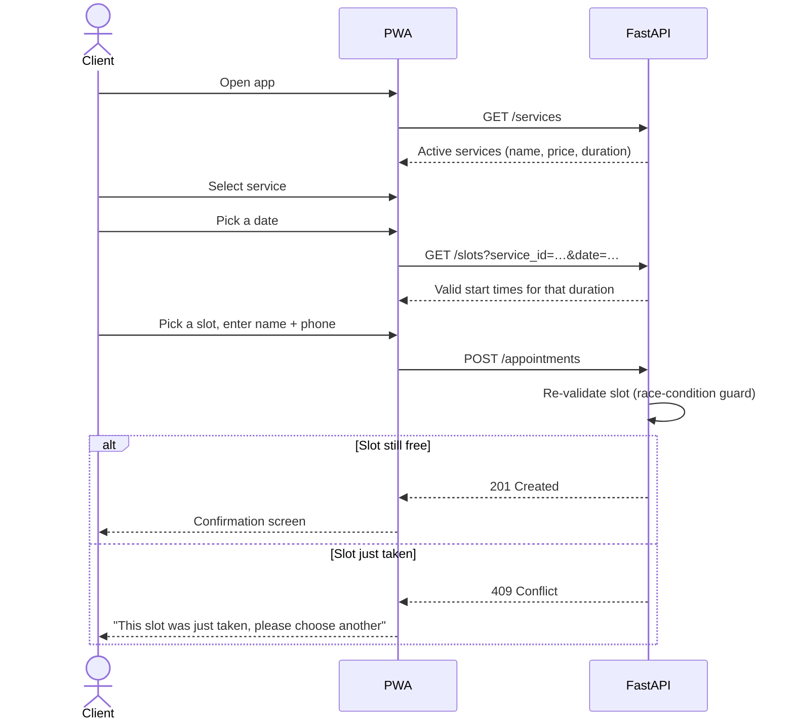

# Client Features

Everything a client can do in the MVP. The guiding principle: **zero friction** — no sign-up, no password, no app store.

## Guest authentication & identification

- There is **no** mandatory account creation or password management.
- Clients identify themselves **during the booking flow** with:
    - **Full name**
    - **Phone number**
- These two fields are stored on the appointment and are what the admin sees in her calendar.

!!! note "Why no accounts?"
    The business already has hundreds of clients who book over the phone. Forcing them to register would reduce conversions and add support burden. Phone number is already the natural identifier for this business.

## Service catalog

Clients browse a list of the services the business offers. Each service displays:

| Field | Example |
|---|---|
| Name | Full-head box braids |
| Price | ₪ 450 |
| Estimated duration | 3 h 30 min |

Only **active** services are shown. Disabled services (see [Admin features](admin-features.md#service-configuration)) are hidden from clients but remain in the database for historical appointments.

## Dynamic booking flow

!!! info "Endpoint names are illustrative"
    The exact API paths will be defined during Sprint 2–3. The flow above describes the *behaviour*, which is fixed.

Step by step:

1. **Select a service.** The service's `duration_minutes` is now the key input for everything that follows.
2. **See available days and time slots.** The system presents only slots derived from the admin's **real-time availability**, minus existing bookings. See [Booking algorithm](../architecture/booking-algorithm.md).
3. **Dynamic time blocking.** The system automatically blocks the exact duration required for the chosen service, so no double-booking or overlap is possible. See [Business rules](business-rules.md#dynamic-time-blocking).
4. **Identify and confirm.** Enter full name + phone, submit, see a confirmation screen.

## Self-service cancellation

Clients can cancel their own appointments **independently**, without contacting the owner.

- **Allowed:** cancellation **at least 24 hours (1 day)** before the scheduled start time.
- **Blocked:** anything later. The UI shows a clear message and the client must contact the owner directly.

The lookup mechanism (a link in the confirmation vs. a "find my appointment" form by phone) is decided in [Sprint 4](../roadmap/sprint-4.md). Full rule details in [Business rules](business-rules.md#24-hour-cancellation-rule).

## UX requirements

- **Mobile-first.** Most clients arrive from a WhatsApp link on their phone.
- **Hebrew, RTL layout.**
- **Loading indicators** during every API call.
- **Friendly error messages** — e.g. "This time slot was just taken, please choose another" rather than a raw HTTP status.
- **Installable** — `manifest.json` + service worker so the browser offers "Add to Home Screen". See [Frontend](../architecture/frontend.md).
