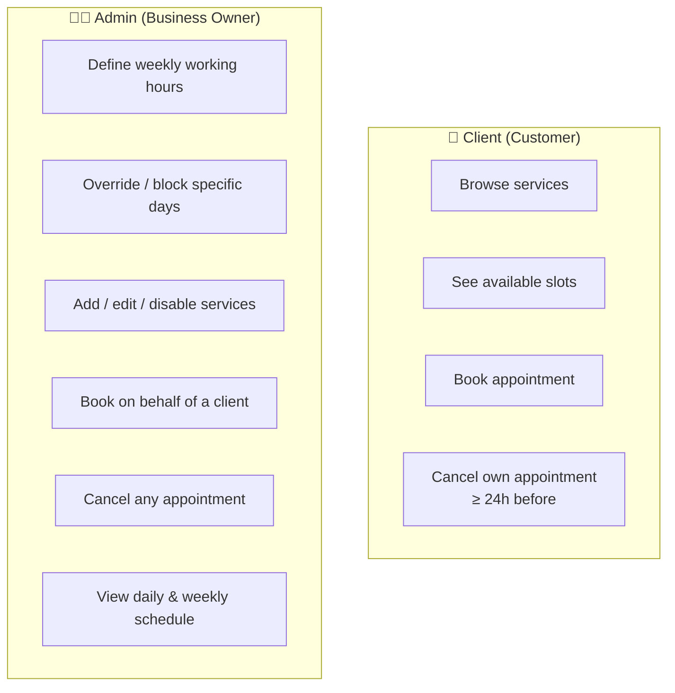

# Product Overview

!!! abstract "Source"
    This section is the living version of the original **Product Requirements Document (PRD)**. If the product changes, change it here.

## What we're building

A dedicated appointment scheduling and management system for a **private braids & hair-styling business** with an existing client base of **hundreds of customers**.

- **Platform:** mobile-first web application, installable as a PWA ("Add to Home Screen")
- **UI language:** Hebrew
- **Replaces:** manual scheduling over phone / WhatsApp

The MVP has exactly two goals:

1. A **frictionless booking experience** for clients — no account, no password, no app store.
2. A **streamlined, dynamic calendar** for the business owner — manage services, hours, and appointments from a phone during the workday.

## User roles

| Role | Who | Authentication | Scope |
|---|---|---|---|
| **Client** | Any existing or new customer | None — identifies with full name + phone during booking | Own appointments only |
| **Admin** | The business owner | Hidden/unlisted admin page (MVP) | Everything |

!!! warning "Admin access in the MVP"
    The roadmap specifies a hidden `/admin.html` page. There is no formal admin authentication scheme defined yet — this is an open item to decide in Sprint 2. See [Sprint 2](../roadmap/sprint-2.md).

## Feature map

| Area | Client | Admin | Details |
|---|:---:|:---:|---|
| Service catalog (name, price, duration) | view | CRUD | [Client](client-features.md#service-catalog) · [Admin](admin-features.md#service-configuration) |
| Availability / working hours | read (implicitly, via slots) | manage | [Admin](admin-features.md#dynamic-calendar-availability-management) |
| Dynamic slot calculation | ✓ | ✓ | [Business rules](business-rules.md#dynamic-time-blocking) |
| Book appointment | own | on behalf of anyone | [Client](client-features.md#dynamic-booking-flow) · [Admin](admin-features.md#appointment-override-control) |
| Cancel appointment | own, ≥ 24 h before | any, any time | [Business rules](business-rules.md#24-hour-cancellation-rule) |
| Daily / weekly schedule view | — | ✓ | [Admin](admin-features.md#dynamic-calendar-availability-management) |

## What's *not* in the MVP

Payments, reminders, CRM/history, and a photo gallery are explicitly deferred. See [Out of scope](out-of-scope.md).

## Success criteria for the MVP

The MVP is "done" when:

- [ ] The owner can configure her services and weekly hours without developer help
- [ ] A client can book a real appointment from a WhatsApp link in under a minute
- [ ] It is **impossible** to create overlapping appointments through the UI or API
- [ ] A client can cancel ≥ 24 h ahead; the system refuses later cancellations with a clear message
- [ ] The app is installable on iOS and Android home screens
- [ ] Production runs on the Hetzner VPS with HTTPS and the frontend on Cloudflare Pages
