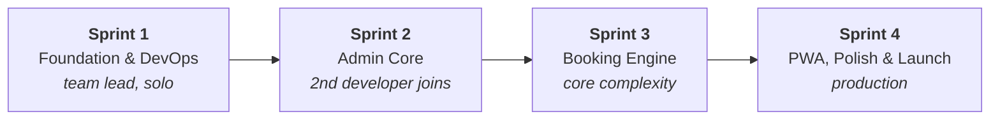
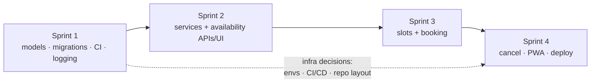

# MVP Roadmap

!!! abstract "Source"
    Living version of the original **MVP Development Plan**. Each sprint page has a checklist — tick items as they merge and keep this in sync with the Kanban board.

Four sprints from an empty repository to a production launch. Sprint 1 is done **solo by the team lead** so the second developer can clone and start writing business logic on day one.

| Sprint | Goal | Key deliverables | Page |
|---|---|---|---|
| **1 — Foundation & DevOps** | Production-ready dev environment and CI so the next developer is productive immediately | Repo + board + branch protection · `docker-compose.dev.yml` · FastAPI skeleton · structured logging · SQLAlchemy models + Alembic baseline · `ci.yml` | [Sprint 1](sprint-1.md) |
| **2 — Admin Core** | Owner can configure services and working hours | Services CRUD API · Availability API · mobile-first admin UI | [Sprint 2](sprint-2.md) |
| **3 — Booking Engine** | Clients can book; double-booking is impossible | Slot algorithm · booking endpoint with re-validation · client flow UI · integration tests | [Sprint 3](sprint-3.md) |
| **4 — PWA & Launch** | Native-feeling app, live in production | `manifest.json` + service worker · 24 h self-cancellation · UX polish · Cloudflare Pages + Hetzner + Caddy + DNS | [Sprint 4](sprint-4.md) |

## Progress

| Sprint | Status |
|---|---|
| Sprint 1 | :hourglass_flowing_sand: In progress — docs ✅, infra design ✅, scaffolding next |
| Sprint 2 | :white_circle: Not started |
| Sprint 3 | :white_circle: Not started |
| Sprint 4 | :white_circle: Not started |

## Dependencies between sprints

The **infra decisions** (environments, CI/CD, project structure) were made in Sprint 1 and are recorded in the [Decision log](../decisions.md); they pay off in Sprint 4.

## Post-MVP backlog

Not scheduled; revisit after launch feedback.

- Staging environment — plan in [Environments → Adding staging later](../architecture/environments.md#adding-staging-later)
- Automated reminders, payments, CRM, gallery — [Out of scope](../product/out-of-scope.md)
- Centralised log shipping and metrics
