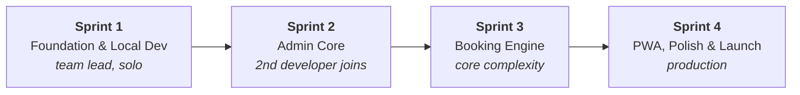
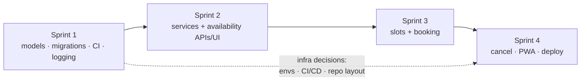

# MVP Roadmap

!!! abstract "Source"
    Living version of the original **MVP Development Plan**. Each sprint page has a checklist — tick items as they merge and keep this in sync with the Kanban board.

Four sprints from an empty repository to a production launch. Sprint 1 is done **solo by the team lead** so the second developer can clone and start writing business logic on day one.

These are GitHub milestones with goals, not fixed two-week timeboxes; no due
dates are set yet. Build and test the MVP locally before buying a VPS or domain.
Production provisioning is a launch-stage decision in Sprint 4.

| Sprint | Goal | Key deliverables | Page |
|---|---|---|---|
| **1 — Foundation & Local Dev** | Run and test backend + DB + frontend locally, without paid infrastructure | Board + templates + solo branch protection · local Postgres · FastAPI + frontend shell · logging · models + Alembic + seed data · CI · local launcher | [Sprint 1](sprint-1.md) |
| **2 — Admin Core** | Owner can configure services and working hours | Services CRUD API · Availability API · mobile-first admin UI | [Sprint 2](sprint-2.md) |
| **3 — Booking Engine** | Clients can book; double-booking is impossible | Slot algorithm · booking endpoint with re-validation · client flow UI · integration tests | [Sprint 3](sprint-3.md) |
| **4 — PWA & Launch** | Launch only after local MVP readiness | PWA + cancellation + polish · production deployment workflow/environment · production Compose + Caddy · hosting + domain/DNS | [Sprint 4](sprint-4.md) |

## Progress

| Sprint | Status |
|---|---|
| Sprint 1 | :hourglass_flowing_sand: GitHub workflow, scaffold, local database and locked backend dependencies ready; API, frontend UI and backend CI still pending |
| Sprint 2 | :white_circle: Not started |
| Sprint 3 | :white_circle: Not started |
| Sprint 4 | :white_circle: Not started |

## Dependencies between sprints

The **infra decisions** (environments, CI/CD, project structure) were made in Sprint 1 and are recorded in the [Decision log](../decisions.md); they pay off in Sprint 4.

## Post-MVP backlog

Not scheduled; revisit after launch feedback.

- Staging environment — plan in [Environments → Adding staging later](../architecture/environments.md#adding-staging-later)
- Automated reminders, payments, CRM, gallery — [Out of scope](../product/out-of-scope.md)
- Centralised log shipping and metrics
